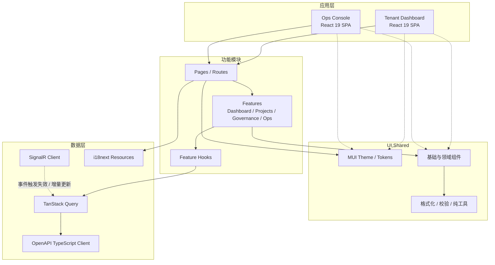

# Regent-Agent 前端技术文档

- 版本：v0.1（待评审）
- 范围：React 19、TypeScript、MUI、应用设计、主题、组件封装、状态管理、SignalR、安全和测试
- 读者：前端研发、设计、QA、架构
- 关联文档：[后端技术文档](./Regent-Agent-后端技术文档.md)、[租户仪表盘信息架构](./design/35-tenant-dashboard-information-architecture.md)、[国际化与本地化](./design/37-internationalization-and-localization.md)、[内部通知中心](./design/41-internal-notification-center.md)、[前端页面与路由地图](./design/48-frontend-route-map.md)

> 当前 React workspace、UI.Shared、组件展示页、Tenant Dashboard 主要页面和 Ops Console 主要页面已实现；完整无障碍、真实 Provider 状态和生产发布仍在后续阶段。

### 当前本地实现

- Tenant Dashboard 已提供组织管理、项目交付闭环、管家问答与报告、安全治理、数据生命周期、模型池、成本调度、评测 QA、合规、通知、消息、工作流、记忆、绩效和设置页面。
- Ops Console 已提供公开状态页、运营状态刷新、租户启停、支持访问审批/撤销、备份、审计和可观测性页面。
- Tenant Dashboard 已提供招聘面试/申诉/公平审计、绩效动作/员工改进、Agent 运行时、任务治理、Prompt/Skill 和 Tool 披露页面。
- `UI.Shared` 已提供 `Stack`、`Grid`、`PageHeader`、`FormField` 以及按钮、文本、卡片、表格、输入、选择、状态和时间线组件，并进入组件注册表。
- API 类型从 `contracts/openapi/controlplane.json` 生成；新增页面使用 TanStack Query 和共享加载、错误、空状态组件。
- Playwright 覆盖登录、项目、员工、工作流、消息、评测、合规、运营台、审批幂等，以及组织/交付/安全/生命周期/模型/成本页面。
- 知识页提供 claim 捕获、混合召回分数、冲突/待复核提示、投毒 Finding、隔离/申诉/解封、独立纠错和影响图操作。
- 交付页提供缺陷修复证据、复测轮次和两轮上限状态；验收、发布、回滚与复盘操作继续使用同一份权威交付状态。
- 工作流页提供个人捕获、提名、采纳/试点/拒绝和运行；绩效页提供改进审查及申诉维持/反转操作。
- 知识页增加候选发布复核队列和归档操作，个人记忆仅作者可见。
- Agent 治理页提供带审批记录的任务改派操作，以及 Prompt 类型、入职基线和公共资产发布。
- 组织页提供经 Boss 批准的再入职操作，并明确私有记忆不会自动恢复。
- 设置页持久化语言、IANA 时区和 ISO 币种，保存后同步切换界面语言。
- 组织页支持章程模板和候选人 JD；招聘页提供候选人状态、拒绝与重试操作。
- 知识页支持个人记忆向上提名和候选发布复核。
- 模型页支持目录添加、轮换和安全删除，并展示绑定恢复状态。
- 所有页面运行在本地 SQLite、JSON、文件和确定性 Provider 模式；未连接远程服务，未创建或测试容器。

## 1. 范围与原则

- 前端使用 **React 19 + TypeScript + MUI（Material Design）**。
- 不使用 Blazor、Razor 或 C# 前端。
- 两个独立应用：
  - `Tenant Dashboard`：租户股东和管理者。
  - `Ops Console`：提供方运营人员。
- 实时通信使用 SignalR TypeScript 客户端。
- 两个应用不共享认证状态、租户上下文、权限或业务 API 客户端。
- 只共享 `UI.Shared` TypeScript 包中的主题、基础组件和工具类型。
- 服务端是权限、业务状态和新鲜度的权威源。

## 2. 技术栈

| 领域 | 技术 | 用途 |
|---|---|---|
| UI 框架 | React 19 | 组件、并发渲染和 Server/Client Component 之外的常规 SPA |
| 语言 | TypeScript strict | 类型安全和 API 契约 |
| 设计系统 | MUI（Material Design） | 组件、主题、图标和交互基线 |
| 样式 | MUI `ThemeProvider`、`sx`、Emotion | 主题令牌和局部样式 |
| 路由 | React Router | 页面、嵌套路由和权限守卫 |
| 服务端状态 | TanStack Query | 请求、缓存、失效、重试和分页 |
| 本地状态 | React State/Context | 仅主题、locale、弹层和短期 UI 状态 |
| 表单 | React Hook Form + Zod | 表单状态和运行时校验 |
| 表格逻辑 | TanStack Table | 排序、筛选、列和分页，MUI 负责呈现 |
| 图表 | MUI X Charts | 预算、成本、趋势和容量图表 |
| 实时通信 | `@microsoft/signalr` | 增量推送、重连和快照补齐 |
| API 客户端 | OpenAPI 生成的 TypeScript Client | 类型安全的内部 API 调用 |
| 国际化 | i18next + react-i18next | zh-CN/en-US 资源和回退 |
| 构建 | Vite | 开发、构建和代码分割 |
| 包管理 | pnpm workspace | 两个应用和一个共享包 |
| 单元/组件测试 | Vitest + Testing Library | Hook、组件和交互测试 |
| 接口 Mock | MSW | 不依赖真实后端的 UI 测试 |
| E2E | Playwright（TypeScript） | 登录、仪表盘、审批和设置 |

依赖原则：

- React 固定 19 大版本，其他依赖在实现时锁定兼容版本。
- 不引入 Redux 作为默认全局状态库。
- 不直接调用数据库、Gateway 数据面或模型 Provider。
- 不使用浮动 CDN 脚本和未固定版本的 UI 依赖。

## 3. 应用结构

```text
frontend/
├─ apps/
│  ├─ tenant-dashboard/
│  └─ ops-console/
└─ packages/
   └─ ui-shared/
```

### 3.1 Tenant Dashboard

- 用户：Boss、Co-Owner、租户管理者。
- 内容：组织、项目、预算、模型、消息、知识、治理、合规和设置。
- 认证：租户 Cookie 会话、CSRF、OIDC 跳转。
- API：Tenant API。
- 实时：SignalR 租户作用域 Hub。

### 3.2 Ops Console

- 用户：Operator、SRE、Security Auditor、Break-glass Operator。
- 内容：租户账户、资源池、事件、SupportGrant、备份和运营审计。
- 认证：独立 Operator 身份、MFA/step-up。
- API：Ops API。
- 实时：SignalR 运营作用域 Hub。

### 3.3 UI.Shared

- MUI 主题和设计令牌。
- 基础布局、表单、反馈和数据展示组件。
- 通用 Hook 和纯函数。
- 不包含：
  - 登录状态。
  - 租户或 Operator 上下文。
  - 业务 API 客户端。
  - 权限判断。
  - 页面路由。

## 4. 应用架构



## 5. 视觉与交互设计

### 5.1 Material Design 基线

- 使用 MUI 组件和默认 Material Design 交互作为基线。
- 通过 ThemeProvider 定制颜色、字体、圆角、阴影和动效。
- 页面不直接写散落的十六进制颜色和像素间距。
- 状态不能只依赖颜色，同时提供图标和文本。
- 危险动作使用明确的确认对话框，不靠悬停才能发现。

### 5.2 设计令牌

| 令牌 | 示例 | 用途 |
|---|---|---|
| `color.primary` | 品牌主色 | 主按钮、选中态、链接 |
| `color.success` | 成功色 | OnTrack、通过、健康 |
| `color.warning` | 警告色 | AtRisk、Stale、待处理 |
| `color.error` | 错误色 | Blocked、Failed、违规 |
| `color.info` | 信息色 | 提示、只读状态 |
| `color.background` | 页面背景 | AppShell 内容区 |
| `color.surface` | 卡片背景 | Paper、Dialog、Menu |
| `text.primary/secondary` | 文本层级 | 标题、正文、辅助说明 |
| `spacing` | 4/8/12/16/24/32 | 布局和组件间距 |
| `radius` | 4/8/12/16 | 卡片、输入框、对话框 |
| `typography` | h1～h6、body、caption | 标题和数据层级 |
| `elevation` | 0～4 | 卡片、菜单、悬浮层 |
| `motion` | 150/250/350ms | 悬停、展开、页面切换 |

### 5.3 页面布局

```text
AppShell
├─ Navigation Rail / Drawer
├─ Top Bar
│  ├─ 租户或运营上下文
│  ├─ 全局搜索
│  ├─ 通知
│  └─ 用户菜单
└─ Content
   ├─ PageHeader
   ├─ Page Content
   └─ Detail Drawer / Dialog
```

- Tenant Dashboard 导航最多两级。
- Ops Console 使用独立导航，不进入租户导航。
- 列表页使用 PageHeader + FilterBar + DataTable。
- 详情页使用 DetailLayout + 标签页 + 右侧证据/审计面板。
- 高风险审批使用固定底部操作栏，明确显示 SLA 和影响。

### 5.4 Boss 首屏

顺序：

1. 公司状态。
2. 待我处理。
3. 项目健康。
4. 预算成本。
5. 组织产能。
6. 风险审计。
7. 最近决策。

规则：

- 每张卡片必须可下钻。
- 卡片独立加载，单卡片失败不阻塞整页。
- 显示数据时间、采集延迟和新鲜度。
- Stale/Unknown 不使用绿色健康状态。
- 不展示全部日常任务、消息、原始日志和无行动含义的图表。

### 5.5 响应式

- 移动端支持首屏、告警确认和升级审批。
- 复杂组织、项目和数据表编辑以桌面为主。
- 断点使用 MUI 默认断点，不手写设备宽度判断。
- 窄屏将 Navigation Rail 转为 Drawer。
- 宽表格使用横向滚动或列选择，不压缩到不可读。

## 6. 主题、国际化与格式化

### 6.1 MUI 主题

- `ThemeProvider` 包裹每个应用。
- `CssBaseline` 统一基础样式。
- 主题按应用配置，不共享运行时 Theme 实例。
- 字体、密度和圆角可通过租户或用户偏好覆盖。
- 默认使用浅色主题；深色主题作为主题能力，不阻塞 MVP。
- 组件优先使用 `sx` 和主题令牌，避免大面积全局 CSS。

### 6.2 国际化

- 第一梯队支持 `zh-CN` 和 `en-US`。
- 语言选择顺序：用户 → 租户 → 浏览器 → `zh-CN`。
- 所有文案使用资源 key，不硬编码。
- 缺失翻译回退源语言并记录，不显示资源 key。
- 安全、法务、审批和合规文案必须人工复核。
- 切换语言保留当前路由、筛选和返回位置。

### 6.3 时间、数字和币种

- API 时间为 RFC 3339 UTC。
- 展示使用 IANA 时区和 `Intl`/CLDR。
- 相对时间同时提供准确时间。
- 日期、数字、百分比和排序按 locale 格式化。
- 币种显式使用 ISO 4217，不能从语言推断。
- 金额使用最小货币单位整数，前端不做浮点运算。
- 不同币种分别展示，不自动换算或相加。

## 7. 路由、认证与权限

### 7.1 路由

- 使用 React Router 嵌套路由。
- 页面按功能模块懒加载。
- 路由守卫只负责体验，不替代服务端鉴权。
- 无权限页面显示 PermissionDenied，不泄露资源是否存在。
- 深链接恢复页面、筛选和返回位置。
- 开发期组件页使用 `/dev/components`，由 feature flag 控制，不进入生产导航。

### 7.2 认证

- 租户和运营会话使用 HttpOnly、Secure、SameSite Cookie。
- 前端不把长期 Token 写入 localStorage。
- OIDC 使用重定向流程，前端不接触 client secret。
- CSRF Token 仅用于写请求，不进入日志。
- SignalR 连接复用同一 Cookie 认证，并使用独立 Hub 权限校验。

### 7.3 权限呈现

- 服务端返回 Capability 和可见导航。
- 前端根据 Capability 隐藏或禁用入口。
- 每次 API 调用仍由服务端重新鉴权。
- 菜单隐藏不是安全边界。
- 个人绩效、私人记忆和秘密不进入通用卡片。

## 8. 状态管理与数据流

### 8.1 服务端状态

- 使用 TanStack Query 管理 API 数据。
- Query Key 必须包含租户、资源类型、筛选和分页。
- 默认缓存只用于减少重复请求，不作为业务真相。
- 写操作使用 Mutation，并携带 `Idempotency-Key`。
- 需要版本条件的更新发送 `If-Match`。
- 401 跳转登录，403 显示权限不足，429 显示重试时间。
- 5xx 使用有界退避，不无限自动重试。

### 8.2 SignalR

- SignalR 只推送增量，Postgres 仍是权威源。
- 连接状态分为 `connected`、`reconnecting`、`disconnected`。
- 重连使用指数退避和最大间隔。
- 重连成功后按 `after_id` 或游标补齐增量。
- 事件只触发 Query 失效或精确增量更新，不直接修改权威状态。
- 高频事件节流和合并，避免界面抖动。
- Hub 方法不接收密钥、完整 Prompt 或未脱敏 PII。

### 8.3 本地状态

- React State 用于弹层、步骤、选中项和临时输入。
- Context 只用于主题、locale、会话摘要和通知偏好。
- 不在 Context 中缓存大型列表、账本或项目数据。
- URL 保存可分享的筛选、分页和当前标签页。

### 8.4 表单

- React Hook Form 管理表单状态。
- Zod 校验结构、枚举、金额和日期。
- 服务端错误映射到字段或表单级错误。
- 危险操作需要二次确认。
- SecretRefInput 只接收引用，不接收明文模型密钥。

### 8.5 页面状态

每个数据区域必须覆盖：

- Loading。
- Empty。
- Error。
- Stale。
- Unknown。
- PermissionDenied。
- Success/Undo（如适用）。

空状态必须解释下一步，不能显示误导性的“零风险”。

### 8.6 前端推进方式

采用“先骨架、再纵向闭环、后补组件”的方式：

1. 先实现主题、AppShell、路由、认证、API Client 和 SignalR。
2. 再实现通用 MUI 封装组件和 Boss 首屏。
3. 选择一条纵向链路：登录 → 首屏 → 项目详情 → 员工工作 → 审批。
4. 根据真实页面补齐领域组件、状态和交互。
5. 每完成一个页面，更新组件清单、Story/测试和文档。

不在实现前一次性锁死所有业务组件 Props；先定义职责和边界，页面落地时细化。

## 9. 封装组件清单

### 9.1 MUI 通用封装组件

| 组件 | MUI 基础 | 统一职责与关键属性 |
|---|---|---|
| `Button` | Button | `tone`、`variant`、`loading`、`disabled`、`startIcon` |
| `IconButton` | IconButton | `label`、`tone`、`selected`、`disabled` |
| `ButtonGroup` | ButtonGroup | 操作分组、尺寸和禁用状态 |
| `Icon` | SvgIcon | 统一尺寸、颜色、语义名称和无障碍标签 |
| `Card` | Card | `padding`、`elevation`、`header`、`actions` |
| `Text` | Typography | 单行/多行文本、标题层级、颜色、截断和换行 |
| `Input` | Input | 单行输入、前后缀、错误和禁用状态 |
| `TextField` | TextField | label、helper text、多行、必填和错误 |
| `SearchInput` | InputAdornment | 搜索、清空、防抖和提交 |
| `Select` | Select | options、value、onChange、loading、error |
| `MultiSelect` | Select | 多选、标签展示和清空 |
| `Autocomplete` | Autocomplete | 异步选项、搜索、加载和空状态 |
| `Checkbox` | Checkbox | 受控值、不确定态和错误 |
| `Radio` | RadioGroup | 单选项组、方向和禁用 |
| `Switch` | Switch | 布尔开关、label 和禁用 |
| `Slider` | Slider | 数值范围、步长、marks 和禁用 |
| `Tooltip` | Tooltip | 辅助说明、placement、延迟和键盘触发 |
| `Chip` | Chip | 状态、标签、删除和点击 |
| `Avatar` | Avatar | 用户/员工头像、文字回退和尺寸 |
| `Badge` | Badge | 未读数量、圆点和上限 |
| `Tabs` | Tabs | 标签页、路由同步和徽标 |
| `Accordion` | Accordion | 折叠分组、默认展开和禁用 |
| `Dialog` | Dialog | 通用模态框、焦点、Escape 和尺寸 |
| `Drawer` | Drawer | 左右侧栏、临时/持久和遮罩 |
| `Menu` | Menu | 操作菜单、键盘导航和禁用项 |
| `Popover` | Popover | 轻量浮层、锚点和定位 |
| `Breadcrumbs` | Breadcrumbs | 层级路径、返回和当前项 |
| `Divider` | Divider | 分组分隔、方向和间距 |
| `Link` | Link | 内部/外部链接和安全属性 |
| `LinearProgress` | LinearProgress | 顶部或卡片加载进度 |
| `CircularProgress` | CircularProgress | 局部加载和按钮进度 |
| `Skeleton` | Skeleton | 文本、矩形和圆形骨架 |
| `Pagination` | Pagination | 页码、每页数量和总数 |
| `List` | List | 通用列表、密度和分隔 |
| `ListItem` | ListItem | 主副文本、图标、操作和选中 |
| `FormControl` | FormControl | label、error、required 和布局 |
| `FormLabel` | FormLabel | 标签、必填和禁用 |
| `FormHelperText` | FormHelperText | 帮助和错误文案 |
| `Stack` | Stack | 间距、方向和换行 |
| `Grid` | Grid | 响应式列、断点和间距 |

通用组件规则：

- 页面和 feature 不得直接散写 MUI Button、Typography、TextField、Select、Tooltip、Card 等原语，必须使用统一封装。
- 相同呈现或交互第二次出现时必须抽取组件。
- 使用语义属性，如 `tone="danger"`，不在业务页面直接散落 MUI color。
- 所有异步组件统一 `loading`、`empty`、`error` 和 `disabled`。
- Tooltip 只放辅助说明，不隐藏关键操作或唯一状态。
- Input、Select 和表单组件必须支持 label、错误和键盘操作。
- Card、Dialog、Drawer 和 Popover 使用统一圆角、阴影和间距令牌。
- 通用组件不包含租户权限判断和业务 API 调用。

### 9.2 基础与布局组件

| 组件 | 封装内容 | 关键属性/行为 |
|---|---|---|
| `AppShell` | 导航、顶栏、内容区和通知宿主 | `appKind`、`navigation`、`children` |
| `NavigationRail` | MUI Drawer/List 的导航容器 | `items`、`collapsed`、`onNavigate` |
| `TwoLevelNav` | 最多两级导航和 Capability 过滤 | `groups`、`capabilities` |
| `TopBar` | 租户/运营上下文、搜索、通知、用户菜单 | `contextLabel`、`actions` |
| `PageHeader` | 标题、说明、操作和返回 | `title`、`subtitle`、`actions` |
| `DetailLayout` | 主内容、侧栏、标签页 | `tabs`、`aside`、`breadcrumbs` |
| `SectionCard` | 统一 Paper 卡片 | `title`、`action`、`loading` |
| `PageTransition` | 轻量页面动效 | 遵循 reduced motion |

### 9.3 数据展示组件

| 组件 | 封装内容 | 关键属性/行为 |
|---|---|---|
| `MetricCard` | 指标、趋势、单位、新鲜度和下钻 | `value`、`delta`、 `freshness`、`href` |
| `StatusChip` | 状态颜色、图标和文本 | `status`、`size`、`variant` |
| `SeverityBadge` | Critical/High/Medium/Low | `severity`、`label` |
| `FreshnessBadge` | Live/Fresh/Stale/Unknown | `freshness`、`dataAt` |
| `DataTable` | MUI Table + TanStack Table | `columns`、`query`、`rowActions` |
| `FilterBar` | 搜索、筛选、排序和重置 | `filters`、`onChange` |
| `KeyValueList` | 只读字段和复制操作 | `items`、`columns` |
| `AuditTimeline` | 审计事件、操作者和证据 | `events`、`emptyText` |
| `Timeline` | 通用时间线容器、顺序和密度 | `items`、`order`、`density` |
| `TimelineItem` | 时间、标题、描述、状态、操作者和证据 | `timestamp`、`status`、`evidenceRefs` |
| `TimelineGroup` | 按日期或阶段分组、折叠和空状态 | `label`、`items`、`collapsible` |
| `CostBreakdownChart` | 原币成本、项目和员工分布 | `currency`、`series` |
| `EmptyState` | 空状态和下一步动作 | `title`、`description`、`action` |
| `ErrorState` | 请求失败和重试 | `error`、`onRetry` |
| `SkeletonBlock` | 卡片、表格和详情骨架 | `variant`、`lines` |

### 9.4 表单与反馈组件

| 组件 | 封装内容 | 关键属性/行为 |
|---|---|---|
| `FormDialog` | MUI Dialog + 表单提交状态 | `open`、`title`、`onSubmit` |
| `ConfirmDialog` | 危险动作二次确认 | `severity`、`confirmText` |
| `ApprovalPanel` | 审批选项、影响、SLA 和证据 | `approval`、`onDecision` |
| `SecretRefInput` | 只输入 `secret_ref` | `value`、`onChange` |
| `ProviderRegionSelect` | Provider/模型/区域选择 | `providers`、`allowedRegions` |
| `MoneyInput` | 最小货币单位金额输入 | `currency`、`value` |
| `DateTimeField` | UTC 值与 IANA 时区展示 | `value`、`timezone` |
| `LocaleSelect` | zh-CN/en-US 和租户默认 | `value`、`onChange` |
| `AlertBanner` | 全局或页面级提示 | `severity`、`message` |
| `SnackbarHost` | 成功、失败和撤销 | `notifications` |
| `ErrorBoundary` | React 渲染错误兜底 | `fallback`、`onReset` |
| `PermissionDenied` | 无权限和返回操作 | `resource` |

### 9.5 租户领域组件

| 组件 | 功能 |
|---|---|
| `CompanyStatusCard` | 当前目标、运行状态、里程碑和更新时间 |
| `PendingActionsCard` | 待我处理数量、严重度、SLA 和负责人 |
| `ProjectHealthCard` | 项目阶段、健康状态和下一里程碑 |
| `BudgetCostCard` | 已用、预算、燃烧速率、预测、Unallocated 和异常 |
| `OrganizationCapacityCard` | 在岗、可用、过载、异常和招聘中 |
| `RiskAuditCard` | 未关闭事件、审计、删除和许可异常 |
| `RecentDecisionList` | 决定、理由摘要、结果和证据 |
| `ActionCenterList` | 去重行动项、严重度、负责人和下一步 |
| `ProjectStageStepper` | 项目工作流阶段和门禁 |
| `OrganizationTree` | 动态岗位、员工和汇报关系 |
| `EmployeeStateBadge` | Active/Busy/Sleeping 等状态和原因 |
| `ModelBindingCard` | 模型、版本、推理强度、协议和状态 |
| `NotificationMenu` | 站内通知、已读、确认和归档 |
| `ButlerPanel` | 只读摘要、证据链接和不确定性提示 |
| `ComplianceStatusCard` | ComplianceProfile、必需控制和违规 |
| `JudgeAssignmentCard` | Judge 员工、模型独立性和校准状态 |

### 9.6 运营领域组件

| 组件 | 功能 |
|---|---|
| `TenantAccountTable` | 租户状态、配额和资源使用 |
| `RunnerPoolPanel` | Runner/Gateway 容量、版本和 drain |
| `IncidentTimeline` | SEV 事件、IC、处置和恢复 |
| `SupportGrantPanel` | 授权范围、有效期、审批和撤销 |
| `BackupStatusCard` | 组件开关、最近成功和有效 RPO/RTO |
| `OpsAuditTable` | 运营操作者、动作、目标和证据 |

### 9.7 项目与员工页面候选组件

以下组件先确定职责，具体 Props 在对应页面实现时冻结。

| 组件 | 功能与设计要点 |
|---|---|
| `ProjectListCard` | 项目名称、阶段、健康、负责人、下一里程碑和预算偏差 |
| `ProjectDetailHeader` | 项目目标、状态、负责人、截止时间、关键操作和返回 |
| `RequirementTree` | 需求层级、验收标准、任务覆盖和展开状态 |
| `TaskBoard` | 按状态或看板展示任务、WIP、优先级和认领人 |
| `TaskDetailDrawer` | 任务类型、能力、依赖、检查点、证据和成本 |
| `DependencyGraph` | 任务依赖、阻塞关系和关键路径 |
| `ReviewFindingsList` | 评审 findings、严重度、作者、状态和证据 |
| `DefectList` | 缺陷严重度、复测状态、责任人和关联需求 |
| `ReleaseChecklist` | 测试、安全、许可、权利、迁移和回滚门禁 |
| `EvidencePanel` | DoneEvidence、Artifact、测试、审计和来源 |
| `EmployeeWorkTimeline` | 按时间显示员工任务、阶段、检查点、成果、成本和异常 |
| `WorkLedgerTable` | 任务类型、权重、质量、能力匹配、成本和证据 |

`EmployeeWorkTimeline` 规则：

- 使用 `Timeline`、`TimelineItem` 和 `TimelineGroup` 组合。
- 支持按员工、项目、任务类型和时间范围筛选。
- 每个事件显示发生时间、任务、状态、动作和下一步。
- 成果和证据通过授权链接下钻，不在时间线内展示秘密。
- 成本使用原币，异常与正常事件使用不同状态标记。
- SignalR 增量更新不得重复插入同一事件。
- 时间线是展示投影，不替代任务、账本或审计权威记录。

### 9.8 组件展示页组件

| 组件 | 功能 |
|---|---|
| `ComponentGalleryPage` | 组件目录路由、分类、搜索和预览 |
| `ComponentCategoryNav` | 按 MUI、布局、数据、表单、租户、运营、项目分类 |
| `ComponentSearch` | 按名称、描述和标签搜索 |
| `ComponentCatalog` | 从注册表渲染组件卡片和状态 |
| `ComponentDemo` | 挂载真实组件并展示默认示例 |
| `ComponentStateMatrix` | 展示 loading、empty、error、disabled、Stale 等状态 |
| `ComponentPropsPlayground` | 仅调整安全的纯 UI 属性 |
| `ComponentStatusBadge` | Stable、Candidate、Deprecated 状态 |

## 10. 工程目录与代码组织

```text
frontend/apps/tenant-dashboard/src/
├─ app/                 # 应用启动、Provider、路由
├─ pages/               # 路由页面
├─ features/            # 业务功能模块
│  ├─ dashboard/
│  ├─ projects/
│  ├─ organization/
│  ├─ models-budget/
│  ├─ governance/
│  └─ settings/
├─ components/          # 应用私有组件
├─ hooks/               # 应用私有 Hook
├─ lib/
│  ├─ api-client/       # OpenAPI 生成客户端
│  ├─ signalr/          # Hub 连接和事件
│  ├─ i18n/             # 语言资源
│  └─ format/           # 日期、数字、币种
├─ theme/               # 应用主题扩展
└─ types/               # 应用类型

frontend/apps/ops-console/src/
└─ 与 Tenant Dashboard 相同分层，但功能域独立

frontend/packages/ui-shared/src/
├─ components/
├─ component-gallery/
│  ├─ component-registry.ts
│  ├─ demos/
│  └─ gallery/
├─ theme/
├─ tokens/
├─ hooks/
├─ utils/
└─ types/
```

规则：

- `features` 之间不直接引用对方内部组件。
- 跨功能复用组件提升到 `UI.Shared` 或应用级 `components`。
- API 类型由 OpenAPI 生成，不手写重复 DTO。
- 页面组件负责组合，不承载复杂业务算法。
- 组件文件保持单一职责，样式和测试就近放置。

## 11. 组件 API 规范

### 11.1 属性设计

- 所有公开组件使用 TypeScript `interface` 或 `type` 导出 Props。
- 属性名使用业务语义，不暴露 MUI 实现细节。
- 受控组件通过 `value + onChange` 工作。
- 非受控组件必须明确默认值和回调时机。
- 异步操作暴露 `loading`、`error` 和 `onRetry`。
- 列表组件使用稳定 `id`，不使用数组索引作为 Key。
- 组件不直接调用 API，由页面或 Feature Hook 注入数据。

### 11.2 示例

```tsx
interface MetricCardProps {
  title: string;
  value: string;
  unit?: string;
  delta?: number;
  freshness: 'live' | 'fresh' | 'stale' | 'unknown';
  dataAt: string;
  href?: string;
  loading?: boolean;
}
```

### 11.3 MUI 使用规范

- 组件内部使用 MUI 作为呈现基础。
- 主题通过 `useTheme` 或 `sx` 令牌取值。
- 不把 MUI 组件类型暴露为业务 Props。
- 允许通过 `slotProps` 或明确扩展点定制，不无限转发所有属性。
- 不用嵌套 `Box` 表达所有间距，优先使用 Stack/Grid。
- 图表、表格和复杂表单必须支持加载、空和错误状态。

### 11.4 可访问性基础

- 完整 WCAG 2.2 AA 支持按 Q-040 后置。
- 当前仍提供语义标签、表单 label、焦点状态和文本状态。
- 图标按钮必须有 `aria-label`。
- 对话框必须管理焦点和 Escape 关闭。
- 颜色不是唯一状态信号。
- 不宣称当前已满足 WCAG 合规。

## 12. 安全与隐私

- 前端不保存模型密钥、Provider Token 或恢复码。
- 模型配置只传 `secret_ref` 和元数据。
- 不在 URL、日志、分析事件或错误边界中传递秘密。
- 不把完整 Prompt、源码、原始日志或密封评测集放入前端状态。
- 外部链接使用 `rel="noopener noreferrer"`。
- 富文本必须净化，禁止直接注入 HTML。
- CSP、HTTPS、Secure Cookie 和 CSRF 由部署和后端共同保证。
- SignalR 事件仍按租户、成员和 Capability 过滤。
- 权限撤销后前端立即清理相关缓存并断开旧订阅。

## 13. 性能、测试与发布

### 13.1 性能

- 页面和重型图表按路由懒加载。
- 首屏使用服务端只读投影，不查询原始日志。
- 列表使用分页和虚拟化。
- SignalR 高频事件节流。
- 使用 React Profiler 定位无意义重渲染。
- 避免在 render 中创建大对象和函数。
- 首屏初始加载 P95 目标 ≤2 秒。

### 13.2 测试

| 层 | 工具 | 重点 |
|---|---|---|
| 纯函数 | Vitest | 格式化、权限映射、状态展示 |
| 组件 | Testing Library | Props、交互、状态和错误 |
| Hook | Vitest + MSW | 缓存、失效、重试和 SignalR |
| API 契约 | OpenAPI 校验 | 请求/响应类型和错误模型 |
| 视觉回归 | Playwright 截图 | 首屏、卡片、对话框和表格 |
| E2E | Playwright | 登录、仪表盘、审批、设置 |
| 国际化 | Playwright + 伪本地化 | zh-CN/en-US、长文本和格式 |
| 权限 | 组件 + E2E | 隐藏入口、越权 API、缓存清理 |

### 13.3 发布

- pnpm lock file 固定依赖。
- Vite 构建生成静态资源。
- 两个前端独立构建和发布。
- Source Map 不公开发布，保留在受控诊断包。
- 构建时注入公开配置，秘密只在运行时由后端管理。
- CI 执行类型检查、单测、构建、Playwright 和秘密扫描。
- 不在 CI 发布镜像，自托管从 Tag 源码本地构建。

## 14. 组件与页面验收清单

- [ ] React 19 + TypeScript strict + MUI。
- [ ] 两个前端不共享会话、权限或业务 API 客户端。
- [ ] 导航最多两级，运营页面不进入租户导航。
- [ ] Boss 首屏包含七类卡片且均可下钻。
- [ ] Stale/Unknown 不显示为健康绿色。
- [ ] 卡片独立加载，单卡片失败不阻塞整页。
- [ ] SignalR 断线后可按游标恢复。
- [ ] 所有写操作有幂等键和明确反馈。
- [ ] 所有表单覆盖加载、错误和权限状态。
- [ ] zh-CN/en-US 关键流程完整。
- [ ] 时间、数字和币种按 locale 展示。
- [ ] 前端不接触模型密钥或秘密明文。
- [ ] 组件 Props 不暴露 MUI 实现细节。
- [ ] 单元、组件、契约和 Playwright 门禁可执行。
- [ ] `/dev/components` 组件页挂载全部注册组件，生产默认关闭。
- [ ] 完整无障碍支持保持后置，不做虚假合规声明。

## 15. 组件展示页

### 15.1 目标

- 在一个页面查看和试用所有已封装组件。
- 覆盖 MUI 通用组件、布局、数据展示、表单反馈、租户、运营、项目和员工组件。
- 作为开发、设计评审、QA 和视觉回归的统一入口。
- 不进入生产业务导航，不调用真实业务 API。

### 15.2 路由与访问

- 路由：`/dev/components`。
- 通过 `frontend.componentGallery` feature flag 启用。
- 开发和测试环境默认开启，生产默认关闭。
- 深链接：`/dev/components?component=Timeline`。
- 未启用时返回 404 或开发提示，不暴露内部组件目录。

### 15.3 组件注册表

每个组件必须注册：

```ts
interface ComponentRegistryEntry {
  id: string;
  name: string;
  category: ComponentCategory;
  description: string;
  tags: string[];
  status: 'stable' | 'candidate' | 'deprecated';
  demo: ComponentType;
  states?: ComponentDemoState[];
}
```

分类：

- `mui`：MUI 通用封装。
- `layout`：AppShell、PageHeader、DetailLayout 等。
- `data`：表格、卡片、图表、Timeline 等。
- `form-feedback`：表单、对话框、提示和错误状态。
- `tenant`：租户业务组件。
- `operations`：运营组件。
- `project-employee`：项目、员工和时间线组件。

### 15.4 页面结构

```text
ComponentGalleryPage
├─ ComponentCategoryNav
├─ ComponentSearch
├─ ComponentCatalog
│  └─ ComponentCard
│     ├─ 组件名称 / 分类 / 状态
│     ├─ 默认预览
│     └─ 打开完整 Demo
└─ ComponentDetail
   ├─ ComponentDemo
   ├─ ComponentStateMatrix
   ├─ ComponentPropsPlayground
   └─ 属性、事件和使用说明
```

### 15.5 Demo 规则

- 每个组件至少有一个默认 Demo。
- 异步组件展示 loading、empty、error 和 disabled。
- 状态组件展示 Stale、Unknown、成功、警告和失败。
- 表单组件展示默认、错误、禁用和只读。
- 图表和 Timeline 使用固定的脱敏示例数据。
- 候选组件显示 `Candidate`，不冒充已完成。
- Props Playground 只能调整颜色、尺寸、状态、文本等纯 UI 属性。
- Playground 不能调用 API、读取密钥或修改真实业务数据。

### 15.6 搜索与深链接

- 支持按组件名、中文描述、分类和标签搜索。
- URL 保存分类、搜索词和当前组件。
- 刷新后恢复当前 Demo。
- 组件改名时保留稳定 `id` 和重定向。
- 废弃组件标记 `Deprecated` 并显示替代组件。

### 15.7 注册覆盖校验

- `UI.Shared` 导出的业务组件必须全部注册。
- CI 检查注册表与导出清单差异。
- 新组件未注册时构建或测试失败。
- 注册组件未实现 Demo 时测试失败。
- Demo 快照纳入 Playwright 视觉回归。
- 组件页自身组件也进入注册表。

### 15.8 性能

- 组件预览按需渲染，长目录虚拟化。
- 图表、大型表单和复杂 Timeline 懒加载。
- Props Playground 更新只影响当前 Demo。
- 不在组件页加载真实租户大数据。

### 15.9 验收场景

1. 所有已注册组件都能在组件页找到。
2. 每个组件都有默认 Demo 和必要状态矩阵。
3. 分类、搜索和深链接可用。
4. Candidate 和 Deprecated 状态清晰。
5. 组件页不调用真实业务 API。
6. 新组件未注册或未提供 Demo 时 CI 失败。
7. 组件页生产默认关闭。
8. 视觉回归覆盖关键组件和状态。
