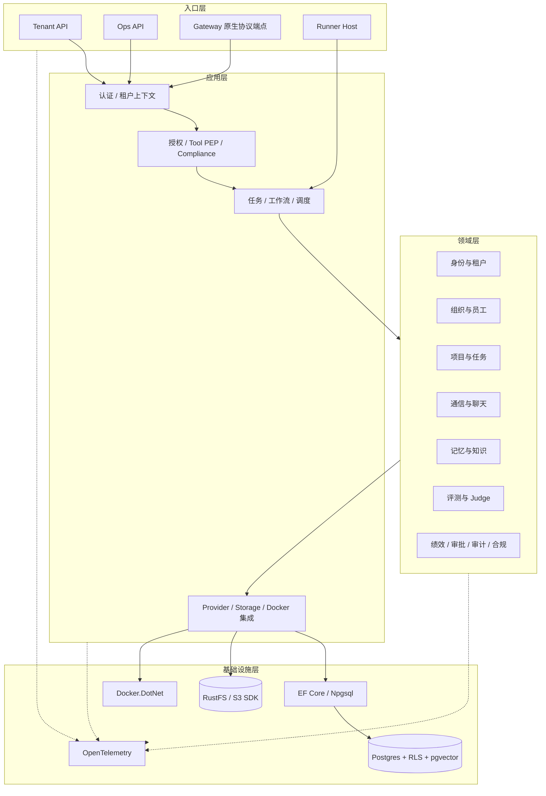
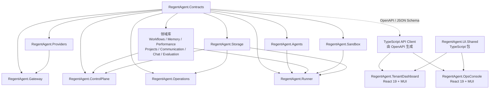

# Regent-Agent 后端技术文档

- 版本：v0.1（待评审）
- 范围：后端技术栈、术语、项目/模块划分、依赖规则、数据边界、API、运行时、安全与测试
- 读者：后端研发、架构、QA、SRE、安全评审
- 关联文档：[技术设计总览](./Regent-Agent-技术设计.md)、[完整架构流程图](./Regent-Agent-架构流程图.md)、[OpenAPI 基线](./design/47-openapi-baseline.md)、[核心 ERD 与数据字典](./design/49-core-data-model-and-erd.md)、[详细设计索引](./design/README.md)

> 当前 16 个后端项目已建立，ControlPlane、Gateway、Runner、Operations 和主要领域模块可在本地 SQLite/JSON/文件模式下运行；本地密码、恢复码、会话、邀请、所有权委托和 OIDC/GitHub 适配边界已实现，真实远程 IdP、Provider 和生产存储仍未接入。

## 1. 文档定位

- 技术总览说明系统为什么这样设计。
- 本文说明后端使用什么技术、划分哪些库和模块、各模块负责什么。
- 详细设计说明具体契约、状态机、算法和失败处理。
- 本文与详细设计冲突时，以对应详细设计为准。

当前实现边界：

- 单租户、单机自托管为 MVP 基线。
- 四个部署服务：ControlPlane、AI Gateway、Runner、Operations Platform。
- 两个独立前端：Tenant Dashboard、Ops Console。
- 模型只支持 OpenAI 与 Anthropic 云端原生端点。
- API、Tool、MCP 和通知均只用于系统内部。
- GitHub 只保存源码和版本 Tag；本地用 Docker Compose 构建。
- Q-033 数据导出、Q-046 支付/套餐/定价保持延后。
- 本地身份使用 PBKDF2 密码哈希、一次性恢复码、持久会话和登录限流；会话撤销会在后续请求生效。
- OIDC/GitHub 使用本地适配契约校验 `issuer + subject`，不发起远程网络请求。
- 租户邀请、Co-Owner、限时所有权委托和 Boss 展示后缀已提供 API 与设置页面。
- 管家支持确定性问答、定时/事件报告和失败重试；Operations 提供本地健康检查、公开状态页、租户启停和支持访问审批。
- 记忆模块提供确定性 256 维向量、关键词/向量/图混合召回、冲突提示、低风险降权、投毒隔离、独立纠错、影响记录和索引删除传播；生产 pgvector/全文检索仍未接入。
- 记忆检测、隔离、申诉、纠错和影响事件写入哈希审计与 Outbox，并通过站内通知提醒；SQLite Outbox 排序在内存执行以兼容当前本地提供程序。
- 组织服务强制四层深度、20 人编制、岗位状态和合并防环；离职释放槽位，章程、岗位、任职、委托和招聘变更写入哈希审计。
- 审批每分钟执行过期作业，超时默认拒绝并写入审计和通知；也可通过 `POST /v1/approvals/expire-due` 手动触发。
- 交付链路强制 Go 决策证据、验收标准覆盖、能力声明、需求权重精确拆分、高风险拆分审批、执行者独立评审、DoneEvidence 全覆盖、2～3 人独立验收、缺陷两轮复测和 P0/P1 发布门禁。
- 工作流支持个人捕获、向上提名、独立采纳/试点/拒绝和不可变执行版本；绩效动作、改进审查和申诉复核均写入哈希审计。
- 记忆检索和详情执行个人作者 ACL，图查询逐节点过滤；组织/知识库捕获进入候选队列，独立复核后才发布，归档停止召回但保留追溯。
- 任务认领按能力、历史、工具、成本、容量和独立性加权且幂等；改派必须携带理由和审批记录。
- PromptBundle 区分招聘、入职和运营用途，支持版本激活回滚、入职基线和不可重复的公共资产发布记录。
- 记忆可绑定 Task 上下文；隔离、纠正或删除 claim 时，引用该 claim 的在途上下文自动标记 Stale，必须重新检索。
- 离职结束任职周期、释放岗位并隔离私有记忆；再入职需 Boss 批准、保留永久工号且不自动恢复私有记忆。
- 记忆纠错若影响已执行外部动作，会自动创建 SEV2 安全事件并附影响记录引用。
- 本地化设置按租户持久化 locale、IANA 时区和 ISO 4217 币种，更新递增版本并在边界校验。
- 章程提供基础/受监管模板并支持自定义版本；招聘要求岗位 JD，支持拒绝、重试、Boss 录用批准、公平审计和申诉。
- 个人记忆可沿岗位向上提名为组织候选，原记录、置信度和 taint 保留，候选独立复核后才进入召回。
- 模型目录支持手工添加、契约测试、版本轮换和绑定引用保护删除；轮换后员工绑定进入 RestoreRequired。管家安全问答和报告实时读取治理事件。
- Gateway 通过 `ProviderMode` 选择本地或远程适配；OpenAI/Anthropic 适配透传原生 JSON、密钥和错误响应，并实施有界超时、重试和 `Retry-After`。模型目录通过 `IModelCatalogSource` 选择本地或 models.dev 源，快照保存原始 JSON 与 checksum。

## 2. 技术栈总览

| 层次 | 技术 | 用途 | 约束 |
|---|---|---|---|
| 语言与运行时 | C#、.NET 10 LTS | 全部后端项目 | 具体 SDK 版本锁定 |
| 服务宿主 | ASP.NET Core、Generic Host、BackgroundService | API、常驻调度、Worker | 四服务可独立部署 |
| Agent 框架 | Microsoft Agent Framework 1.0 | Agent、Workflow、Skill、Hosting | 核心账本、权限、事务不依赖 MAF |
| 并发 | `System.Threading.Channels`、`async/await` | 收件箱、队列、流式处理 | Runner 内队列不是持久真相 |
| API | JSON over HTTPS、OpenAPI、SignalR | 内部 REST、实时状态 | `/v1` 不是公共 API 承诺 |
| 数据访问 | EF Core、Npgsql、PostgreSQL | 关系状态、事务、RLS | 生产禁止 SQLite |
| 向量检索 | PostgreSQL `pgvector` + 全文检索 | 记忆和知识召回 | 先权限过滤，再检索 |
| 对象存储 | RustFS、S3 兼容 SDK | 快照、成果、归档、评测材料 | Ready 对象不可覆盖 |
| 模型接入 | OpenAI、Anthropic 原生 HTTP 端点 | 推理与流式响应 | 不做跨协议转换 |
| 密钥 | Postgres `keyvault` schema + 信封加密 + `secret_ref` | BYOK 模型密钥 | 密文仅 Gateway 可解密，主密钥不进入数据库 |
| 沙箱 | Docker.DotNet、Docker Engine | 团队工位、一次性容器 | 不挂 docker.sock、不 privileged |
| 韧性 | Polly 或等价重试策略 | 超时、退避、熔断 | 所有外部副作用必须幂等 |
| 可观测 | OpenTelemetry | Metrics、Logs、Traces | 默认 local，Elastic 可选 |
| 前端 | React 19 + TypeScript + MUI | Tenant Dashboard 与 Ops Console | 不使用 Blazor 或 C# 前端 |
| 前端实时 | SignalR TypeScript 客户端 | 仪表盘和 Ops Console 增量推送 | 两前端不共享会话 |
| UI 测试 | Playwright（TypeScript/JavaScript） | 关键用户路径 | 与后端 E2E 门禁一起运行 |
| 单元/集成测试 | xUnit + 真实 Postgres/RustFS | 状态机、RLS、事务、契约 | CI 不依赖真实模型 Provider |
| CI/CD | GitHub Actions | 编译、测试、扫描、迁移 dry-run | 不发布镜像 |
| 部署 | Docker Compose + systemd | 单机部署与进程保活 | 从版本 Tag 本地构建 |

技术版本原则：

- 框架大版本遵循本文和项目决策。
- 具体补丁版本在实现时锁定，不手写浮动版本。
- 基础镜像使用可信来源并尽量固定 digest。
- 不引入 Kafka、Kubernetes、GHCR、Gitea/Forgejo 或本地 Ollama。

## 3. 后端术语

### 3.1 租户与身份

| 术语 | 含义 |
|---|---|
| Account | 全局登录账户，可加入多个租户 |
| Tenant | 数据、预算、组织、密钥和审计的安全边界 |
| Company | 租户内的自治公司运行边界；一租户一公司 |
| Membership | 账户在租户中的成员关系 |
| Primary Owner | 每个租户唯一的人类所有者 |
| Co-Owner | 租户共同所有者 |
| OwnerDelegation | 限时、限范围、不可转授权的所有者委托 |
| OIDC Identity | 以 `issuer + sub` 标识的企业身份 |
| SupportGrant | 运营人员访问指定租户的短时授权 |
| Assignment Token | 单租户、单员工、单任务的短期执行身份 |
| Deployment Token | Runner 调用控制面的部署级身份 |

### 3.2 组织与执行

| 术语 | 含义 |
|---|---|
| Controller | 公司级编排 Agent，启动时没有岗位 |
| Position | 数据化岗位，定义能力、模型、预算和汇报关系 |
| EmployeeRuntime | 员工或 Judge 的独立 Agent 运行时 |
| EmployeeRuntimeBinding | 员工与模型、版本、推理强度、协议的绑定 |
| Task | 有类型、权重、能力、授权和完成标准的工作项 |
| TaskRun | Task 的一次具体执行尝试 |
| TaskGrant | 任务预授权的工作区、Tool、网络、预算和动作范围 |
| WorkSchedule | 用户配置的工作、静默、禁用和低价窗口 |
| TaskCheckpoint | 可恢复的任务执行状态，不替代原始事件 |
| Judge Employee | 执行正式评测任务的独立员工运行时 |

### 3.3 Tool、消息与记忆

| 术语 | 含义 |
|---|---|
| ToolManifest | Tool 名称、Schema、权限、副作用和限流声明 |
| Tool Profile | 当前任务默认披露的 Tool 集合 |
| Tool PEP | 每次 Tool 调用执行策略、权限和参数校验的组件 |
| Untrusted Content | 外部网页、Issue、Tool 输出等不可信数据信封 |
| Taint | 不可信来源标记，摘要和记忆提升不能洗白 |
| Outbox / Inbox | 保证事件至少一次投递和消费去重 |
| Fencing Token | 防止旧 Worker 迟到提交覆盖新结果的令牌 |
| Memory Claim | 可单独校验、隔离和纠错的最小记忆单元 |
| CorrectionTask | 对错误记忆生成新版本并传播影响的正式任务 |
| DoneEvidence | 工作项完成的统一证据集合 |

### 3.4 模型、成本与治理

| 术语 | 含义 |
|---|---|
| AI Gateway | 唯一持有模型密钥并执行鉴权、预算和计量的服务 |
| BudgetReservation | 模型调用前的原子预算预留 |
| UsageEvent | Gateway 或 Runner 产生的权威用量事件 |
| LedgerEntry | 只增不改的钱账条目 |
| CostAllocation | 公共成本的显式分摊投影，不新增费用 |
| ComplianceProfile | 租户可配置的合规控制策略 |
| EvaluationRun | 固定模型、Prompt、Tool、Runtime、数据集和 seed 的评测 |
| ScoringRubric | 运行前冻结的评分规则 |
| JudgeCalibration | Judge 员工与人工评分的校准记录 |
| ReleaseManifest | 版本 Tag、commit、Schema 和兼容边界清单 |
| LocalBuild | 目标主机从 Tag 构建镜像的记录 |

## 4. 后端分层



分层规则：

- 入口层只处理协议、认证、绑定、幂等和错误映射。
- 应用层组织用例，不绕过领域不变量。
- 领域层保持纯业务状态和规则，不直接依赖 HTTP 或 Docker。
- 基础设施层封装 Postgres、RustFS、Provider 和 Docker。
- 跨层依赖只能向内，领域层不能引用入口层。

## 5. 解决方案项目与模块

共 19 个模块：16 个后端 .NET 项目、2 个 TypeScript SPA、1 个 TypeScript UI 包。`RegentAgent.slnx` 只包含后端 .NET 项目，前端使用独立 workspace。

### 5.1 项目总表

| # | 项目 | 类型 | 基本职责 |
|---:|---|---|---|
| 1 | `RegentAgent.Contracts` | 类库 | DTO、事件、API 契约、状态引用类型 |
| 2 | `RegentAgent.ControlPlane` | Web/Worker | 租户业务权威、组织、项目、消息、账本和治理 |
| 3 | `RegentAgent.Gateway` | Web/Worker | 模型密钥、原生协议代理、预算和计量 |
| 4 | `RegentAgent.Providers` | 类库 | OpenAI/Anthropic 原生 Provider 实现 |
| 5 | `RegentAgent.Agents` | 类库 | MAF Agent 工厂、Tool、Skill 和上下文装配 |
| 6 | `RegentAgent.Workflows` | 类库 | 工作流版本、执行、检查点和度量 |
| 7 | `RegentAgent.Memory` | 类库 | 分层记忆、RAG、纠错、遗忘和删除传播 |
| 8 | `RegentAgent.Performance` | 类库 | KPI、绩效、自驱动提案、申诉和人事动作 |
| 9 | `RegentAgent.Projects` | 类库 | 项目、需求、任务、缺陷、评审和认领 |
| 10 | `RegentAgent.Communication` | 类库 | 岗位标签、通信画像、双图路由 |
| 11 | `RegentAgent.Chat` | 类库 | 私人/群组聊天、委派、交接和召回 |
| 12 | `RegentAgent.Evaluation` | 类库 | 评测集、Judge、校准、污染检测和统计 |
| 13 | `RegentAgent.Runner` | Worker | Controller/Employee/Judge 宿主、租约和沙箱编排 |
| 14 | `RegentAgent.Sandbox` | 类库 | Docker 容器生命周期、配额、隔离和工具执行 |
| 15 | `RegentAgent.Operations` | Web/Worker | 提供方运营 API、资源池、事件、支持和备份 |
| 16 | `RegentAgent.Storage` | 类库 | RustFS S3 客户端、对象元数据和上传状态机 |
| 17 | `RegentAgent.TenantDashboard` | React 19 SPA | 租户前端，REST + SignalR + MUI |
| 18 | `RegentAgent.OpsConsole` | React 19 SPA | 提供方前端，REST + SignalR + MUI |
| 19 | `RegentAgent.UI.Shared` | TypeScript 包 | 共享视觉组件，不共享会话和业务权限 |

### 5.2 四个部署服务

#### RegentAgent.ControlPlane

- 形态：ASP.NET Core Web API + BackgroundService。
- 权威数据：租户公司、身份、组织、项目、消息、记忆、钱账、审计、审批和通知。
- 主要功能：
  - 认证、租户上下文和 RLS。
  - 组织、岗位、员工和权限。
  - 任务调度、租约、消息和 Outbox/Inbox。
  - Tool 注册、发现、PEP 和执行审计。
  - 预算、账本、成本归属和异常。
  - Butler、内部通知、升级队列和合规策略。
  - 评测编排和密封数据访问代理。
- 不负责：持有模型密钥、执行模型推理、直接操作 Docker。

#### RegentAgent.Gateway

- 形态：ASP.NET Core 原生协议端点 + BackgroundService。
- 权威数据：Postgres `keyvault` schema 中的模型密钥密文和包装数据密钥、模型健康、请求用量和价格快照。
- 主要功能：
  - 验证 assignment/service token。
  - 检查模型绑定、租户、ComplianceProfile 和预算。
  - 原子预留预算并注入模型密钥。
  - 调用 OpenAI 或 Anthropic 原生端点。
  - 记录 token、缓存、推理、延迟和费用。
  - 生成 ModelUnavailableEvent 和熔断状态。
- 不负责：公司任务状态、组织权限、模型协议互转。

#### RegentAgent.Runner

- 形态：Generic Host Worker。
- 主要功能：
  - 注册、心跳、领取任务和续租。
  - 托管 Controller、Employee 和 Judge 运行时。
  - 拉取 Tool Profile 并执行 Tool Call。
  - 管理团队工位和一次性沙箱容器。
  - 上报工具用量、资源和健康。
  - 崩溃后通过租约过期和 fencing 恢复。
- 不负责：持久化业务真相、保存模型密钥、跨 Runner 直接通信。

#### RegentAgent.Operations

- 形态：ASP.NET Core Ops API + BackgroundService。
- 主要功能：
  - 租户账户、状态、配额和资源池。
  - Runner/Gateway 部署版本和 drain。
  - 事件、值班、复盘和运营审计。
  - SupportGrant 和双人紧急访问。
  - 可选备份、恢复审批和演练报告。
- 不负责：直接写租户业务表、读取模型密钥、代替主控管理公司。

### 5.3 基础与集成库

#### RegentAgent.Contracts

- 定义跨服务 DTO、事件信封、错误模型和 API 版本。
- 定义稳定 `snake_case` 状态及 C# 密封引用类型。
- 定义 ToolManifest、Assignment Token、ReleaseManifest 等公共结构。
- 不包含业务逻辑、数据库访问或 Provider SDK。

#### RegentAgent.Providers

- 分别实现 OpenAI Chat Completions 和 Anthropic Messages。
- 保持请求、响应、流式事件和错误结构的原生形状。
- 提供统一的能力接口，但不统一 Provider DTO。
- 不包含密钥存储、预算或公司业务逻辑。

#### RegentAgent.Storage

- 封装 RustFS 的 S3 兼容客户端。
- 管理对象键、校验、加密引用和访问审计。
- 实现 `PendingUpload → Ready` 状态机。
- 提供 Git Bundle、成果、归档和评测材料存储能力。
- 不实现多对象存储后端抽象。

#### RegentAgent.Sandbox

- 封装 Docker.DotNet。
- 创建、启动、停止和清理团队工位及一次性容器。
- 执行 CPU、内存、PID、磁盘、网络和路径限制。
- 禁止 docker.sock、privileged 和跨任务目录访问。
- 当前不挂载 GPU。

#### RegentAgent.Agents

- 封装 MAF Agent 工厂和运行时。
- 装配 Charter、岗位规则、Tool Schema、上下文和检查点。
- 实现有界 Tool-loop、重复检测和无进展恢复。
- 管理 PromptBundle、Skill 版本和稳定前缀缓存。
- 不负责权限最终判定，Tool Call 必须经过 PEP。

### 5.4 领域库

| 项目 | 关键实体/能力 | 主要功能 |
|---|---|---|
| `Workflows` | WorkflowDefinition、Version、Run、Checkpoint | 捕获组织流程、版本审查、执行和收益度量 |
| `Memory` | MemoryClaim、MemoryFinding、CorrectionTask | 分层记忆、混合召回、taint、纠错、遗忘和删除传播 |
| `Performance` | KpiDefinition、PerformanceReview、PerformanceAction | KPI 快照、AI 自主绩效、人类解雇批准和申诉 |
| `Projects` | Project、Requirement、Task、Defect、Review、Decision | 交付闭环、自动拆分、WIP、认领、评审和验收 |
| `Communication` | PositionLabel、CommunicationProfile、Route | 管理链/专业链双图、向上穿透和项目覆盖 |
| `Chat` | Conversation、CollaborationMessage、Delegation、Handoff | 私人/群组聊天、@、打断、确认和加权召回 |
| `Evaluation` | BenchmarkSuite、EvaluationRun、JudgeAssignment | 密封集、污染检测、Judge 员工、校准和统计门禁 |

领域库规则：

- 领域库只依赖 Contracts 和必要的基础抽象。
- 不依赖具体 Web 宿主、Docker 引擎或 Provider SDK。
- 跨领域调用通过应用层用例和事件完成，不互相直接修改内部表。
- 同一事实只有一个权威模块，其他模块保存投影或引用。

### 5.5 前端项目在后端架构中的位置

#### RegentAgent.TenantDashboard

- React 19 + TypeScript + MUI，通过 SignalR TypeScript 客户端接收实时增量。
- 只访问 Tenant API，不直接访问 Gateway 数据面或数据库。
- 承担组织、项目、预算、治理、通知和 Butler 交互。
- 模型配置由服务端调用 Gateway 管理 API，浏览器不接触模型密钥。

#### RegentAgent.OpsConsole

- React 19 + TypeScript + MUI，通过 SignalR TypeScript 客户端接收实时增量。
- 只访问 Ops API，使用独立 Operator 身份和 audience。
- 承担租户账户、资源池、事件、SupportGrant、备份和审计。

#### RegentAgent.UI.Shared

- TypeScript 包，只共享布局、表单、图表和基础组件。
- 不共享认证状态、租户上下文、权限判断或业务 API 客户端。
- 不包含 ControlPlane 或 Operations 领域依赖。

## 6. 项目依赖规则

### 6.1 允许的依赖方向



### 6.2 依赖约束

| 模块 | 可以依赖 | 禁止依赖 |
|---|---|---|
| Contracts | .NET BCL、序列化特性 | 任何业务项目、EF、Provider SDK |
| 领域库 | Contracts、基础抽象 | Web 宿主、Docker、Gateway 密钥 |
| Providers | Contracts、Provider SDK/HTTP | ControlPlane 数据库、Runner |
| Storage | Contracts、S3 SDK | 领域业务判断 |
| Sandbox | Contracts、Docker.DotNet | 公司权限、模型密钥 |
| Agents | Contracts、MAF、领域接口 | 直接数据库写入、PEP 绕过 |
| ControlPlane | Contracts、领域库、Storage | Postgres `keyvault` schema、Docker 引擎 |
| Gateway | Contracts、Providers | ControlPlane 领域表、Runner |
| Runner | Contracts、Agents、Sandbox、Storage | ControlPlane 数据库、模型密钥 |
| Operations | Contracts、Storage、内部 API 客户端 | 直接写租户表 |
| 前端 | TypeScript API Client、UI.Shared、SignalR 客户端 | C# 项目引用、对方前端、数据库、模型密钥 |

- 禁止循环项目引用。
- 禁止通过共享静态可变状态传递租户数据。
- 跨服务只能使用 HTTP/API 或事件契约。
- 具体 SDK 和实现类通过依赖注入替换，不为测试暴露全局单例。

## 7. 运行时与部署单元

| 单元 | 进程形态 | 状态所有权 | 扩缩容方式 |
|---|---|---|---|
| ControlPlane | Web + BackgroundService | Postgres | 先扩展无状态实例，再评估数据库 |
| AI Gateway | Web + BackgroundService | Postgres `keyvault` schema + 模型元数据 | 按 Provider 限额和数据库副本扩展 |
| Runner | Generic Host Worker | 无持久业务状态 | 增加 Runner，租约自动重调度 |
| Operations | Web + BackgroundService | Operations DB | 独立于租户控制面扩展 |
| Tenant Dashboard | React 19 SPA + SignalR 客户端 | 无业务权威状态 | 静态资源多实例 + SignalR 服务端横向扩展 |
| Ops Console | React 19 SPA + SignalR 客户端 | 无业务权威状态 | 独立扩容 |

单机 MVP：

```text
systemd
  └─ Docker Compose
       ├─ Postgres
       ├─ RustFS
       ├─ ControlPlane
       ├─ AI Gateway
       ├─ Runner
       ├─ Operations（可禁用）
       ├─ Tenant Dashboard
       └─ Ops Console（可禁用）
```

- 默认使用 `local` 可观测 Profile，不启动 Elastic 组件。
- 备份默认关闭，由 BackupProfile 独立控制。
- 应用启动不自动迁移数据库。
- 镜像在目标机从 GitHub Tag 构建，记录 LocalBuild。
- 不在 CI 发布镜像，也不使用 GHCR。

## 8. 数据与事务边界

### 8.1 数据所有权

| 数据 | 权威模块/存储 | 写入方式 |
|---|---|---|
| 账户、租户、组织、项目 | ControlPlane / Postgres | 领域服务 + RLS |
| 消息、Outbox、Inbox | ControlPlane / Postgres | 同事务写入 |
| 钱账、预算预留 | ControlPlane / Postgres | 行锁/原子更新 |
| 模型密钥 | Gateway / Postgres `keyvault` schema | 信封加密写入，控制面只存 `key_ref` |
| 模型用量 | Gateway → ControlPlane | 至少一次投递、幂等去重 |
| 工具用量 | Runner → ControlPlane | 至少一次投递、幂等去重 |
| 快照、成果、归档 | RustFS | PendingUpload → Ready |
| 活动 worktree | Runner 本地/容器 | 临时数据，可丢失 |
| 密封评测数据 | 隔离评测存储 | 仅评测服务访问 |
| 运营账户、资源池、SupportGrant | Operations DB | 独立运营权限和审计 |

### 8.2 事务规则

- 单库短事务维护即时不变量。
- 跨模块使用 Outbox、Inbox、Saga 和补偿，不使用 XA/2PC。
- 创建类 API 必须带 `Idempotency-Key`。
- 更新类 API 必须带 `If-Match` 或等价版本条件。
- 模型调用、Tool 调用和 RustFS 上传不包在数据库事务中。
- 预算预留、编制占用和任务认领必须使用原子条件更新。
- 迟到用量按发生周期入账，关闭周期通过更正条目处理。
- 原始账目和审计事件只增不改。

### 8.3 Gateway 加密密钥库

- 密文、包装数据密钥和版本元数据存储在 Postgres `keyvault` schema。
- Gateway 使用独立数据库角色，只访问 `keyvault` schema，不访问 ControlPlane 领域表。
- 主密钥来自环境变量、宿主机 secret 文件或外部密钥系统，不进入 Postgres。
- Provider API Key 使用数据密钥加密，数据密钥再由主密钥包装，实现信封加密。
- `keyvault` 表启用 `tenant_id` 和 RLS，Gateway 每次访问设置租户上下文。
- 数据库不保存 API Key 明文、可逆标识或密钥哈希。
- 轮换创建新版本并原子切换 `active_key_version`，旧版本供在途请求结束。
- 删除模型时删除密文和版本，保留不包含秘密的审计元数据。
- 密钥库备份只包含密文和包装数据密钥，主密钥必须从独立保管处恢复。

## 9. API、Tool 与消息契约

### 9.1 API 通用约定

- 基础路径 `/v1`，JSON over HTTPS。
- 每个响应包含 `request_id`。
- 创建类接口使用 `Idempotency-Key`。
- 更新类接口使用 `If-Match: "<row_version>"`。
- 列表使用 `limit + cursor`，禁止无限 offset。
- 时间使用 RFC 3339 UTC，展示时区单独传递。
- 错误模型包含 `code`、`message`、`retryable` 和受限 `details`。
- 内部 API 不构成公共兼容性承诺。

### 9.2 API 域与归属

| API 域 | 主要模块 | 说明 |
|---|---|---|
| 认证与租户 | ControlPlane | 本地密码、GitHub、OIDC、成员和所有权 |
| 组织 | ControlPlane + Organization domain | 岗位、员工、能力、汇报关系和继任 |
| 项目与任务 | ControlPlane + Projects | 项目、需求、任务、缺陷、评审和认领 |
| 通信与聊天 | ControlPlane + Communication/Chat | 路由、消息、委派、交接和召回 |
| Tool | ControlPlane + PEP | 发现、展开、激活、调用和撤销 |
| 模型数据面 | Gateway | OpenAI/Anthropic 原生端点 |
| 模型管理 | Gateway Admin API | BYOK 元数据、测试、轮换和删除 |
| 计量与预算 | ControlPlane | 用量、账本、预留、对账和异常 |
| 评测 | ControlPlane + Evaluation | 数据集、运行、Judge、审批和复测 |
| 治理 | ControlPlane | 升级、审计、合规、通知和 Butler |
| 运营 | Operations | 租户、资源池、事件、SupportGrant 和备份 |
| 运行接入 | ControlPlane + Runner | 注册、心跳、领取、续租和完成 |

### 9.3 Tool 与 MCP

- 员工 Tool 以 `AIFunction` 和 ToolManifest 为主。
- MCP 只用于 Butler 只读工具和模型评测工具面。
- 不提供公共 MCP Server 市场或通用插件协议。
- Tool 发现结果不能替代执行时鉴权。
- 每次调用校验身份、租户、能力、TaskGrant、预算和参数。
- 外部写动作绑定幂等键、审批和审计。

### 9.4 消息与事件

- 公司通信必须经过 ControlPlane 消息表。
- Runner 之间不直接发送业务消息。
- 同一接收人内按 `seq` 有序，不承诺全局有序。
- Outbox 与业务状态同事务提交。
- Inbox 按消费者和事件 ID 去重。
- 毒消息进入死信，不能无限阻塞后续消息。
- 通知只持久化到仪表盘，SignalR 仅负责实时提示。

## 10. 安全、权限与合规

### 10.1 身份边界

- Human、Operator、Runner、Gateway、Butler 使用不同 audience 和 scope。
- 租户 Token 不能访问 Ops API，Operator Token 不能直接访问 Tenant API。
- SupportGrant 必须绑定 operator、tenant、scope 和有效期。
- 员工 Token 不包含模型管理、预算修改或审批权限。
- 密钥轮换使用 `kid` 重叠，吊销最长传播延迟 60 秒。

### 10.2 数据边界

- 所有租户业务表启用强制 RLS，应用角色不得 BYPASSRLS。
- 请求体中的 `tenant_id` 不能作为身份依据。
- 对象键包含租户和资源范围，但前缀不是安全边界。
- RustFS 访问结合 IAM、短期凭据或签名 URL。
- 日志、Trace、缓存和构建产物不得包含密钥、完整 Prompt 或未脱敏 PII。

### 10.3 Tool 与沙箱

- 沙箱默认断网，按角色开放白名单。
- 不挂载 docker.sock，不使用 privileged。
- 只挂载当前任务工作区，不暴露宿主目录。
- 外部内容保留来源、hash 和 taint。
- 安装、构建和危险脚本在隔离环境执行。

### 10.4 ComplianceProfile

- 支持 baseline、strict 和自定义预设。
- 配置 Provider/区域、数据分级、保留、审计、备份和外部共享。
- 必需控制不满足时 fail closed。
- 策略版本化，激活需审批，历史任务保留生效版本。
- 技术证据不等于认证，不宣称 SOC 2、ISO 27001 或等保。

## 11. 可观测性与测试

### 11.1 可观测性

- 四个服务和两个前端统一接入 OpenTelemetry。
- 默认 Profile 为 `local`，支持 `off`、`otlp`、`elastic`。
- 高基数 ID 只进入日志和 Trace，不作为全局指标标签。
- 错误、L2/L3、预算、越权和关键发布路径保留 Trace。
- 遥测后端故障不得阻塞核心业务。

默认目标：

| 指标 | 目标 |
|---|---:|
| 控制面月度可用性 | ≥99.5% |
| 普通读 API P95 | ≤300ms |
| 普通写 API P95 | ≤500ms |
| 任务领取 P95 | ≤2 秒 |
| 消息消费 P95 | ≤10 秒 |
| 用量入账 P95 | ≤60 秒 |
| Outbox/RustFS 成功率 | ≥99.5% |

### 11.2 测试分层

| 测试层 | 重点 |
|---|---|
| 单元测试 | 状态机、权限、权重、预算、评分和策略 |
| 组件测试 | 单模块行为和外部依赖替身 |
| 集成测试 | 真实 Postgres/RustFS、RLS、Outbox、上传 |
| 契约测试 | OpenAI/Anthropic 原生语义和错误结构 |
| E2E | 建岗、招聘、任务、评审、验收和发布 |
| UI | Tenant Dashboard 与 Ops Console 关键路径 |
| 安全 | 越权、SSRF、路径穿越、密钥和容器隔离 |
| 评测 QA | 密封集、污染、Judge 校准和统计门槛 |
| 容量 | 20 员工、40 并行任务、突发和 24 小时 soak |
| 升级 | N/N-1、Expand/Contract、回滚和恢复 |

质量门禁：

- 整体行覆盖率 ≥80%。
- 安全、预算、账本、RLS 和状态机等关键模块 ≥90%。
- 不允许静默跳过失败测试。
- CI 使用 GitHub Actions，不依赖真实 Provider。
- 容量测试摘要进入发布门禁。

## 12. 实施顺序

| 阶段 | 优先项目 | 交付目标 |
|---|---|---|
| 1 | Contracts、ControlPlane 骨架、Storage | 租户、身份、Outbox、双账本和 RLS 可运行 |
| 2 | Runner、Sandbox、Agents | 注册、租约、员工运行时和沙箱恢复 |
| 3 | Gateway、Providers | 两类原生模型端点、预算预留和计量 |
| 4 | Projects、Communication、Chat | 项目交付、消息路由和协作闭环 |
| 5 | Workflows、Memory、Evaluation | 主控自主闭环、组织知识和评测复用 |
| 6 | Performance、治理模块 | KPI、审批、审计、合规和内部通知 |
| 7 | Tenant Dashboard、Ops Console、Operations | 租户治理、运营支持、备份和状态观测 |
| 8 | 安装/升级脚本与容量测试 | Tag 源码 Compose 自托管、回滚和 soak |
| 9 | QA 与发布加固 | 安全、评测 QA、许可、升级和容量门禁 |

阶段 5 对应“公司成立”里程碑；阶段 1～8 对应首个完整自主交付 MVP。支付、套餐和定价不进入当前实施顺序。

## 13. 当前非目标

- 本地 GPU、Ollama 和本地模型档。
- Telegram、邮件、短信、其他 IM 和出站 Webhook。
- 公共 API、公共 SDK、MCP/插件市场、跨租户 Skill 分享。
- 二进制/GUI 安装包、激活和自动更新。
- 支付、套餐、定价和订阅计费。
- 企业认证声明、商业 SLA 和专属支持。
- 大规模多租户容量承诺。

## 14. 模块完成检查表

- [ ] 项目引用符合第 6 节，无循环依赖。
- [ ] 所有跨服务 DTO 和事件来自 Contracts。
- [ ] 所有租户查询带租户上下文并通过 RLS。
- [ ] 所有创建和外部写操作具备幂等键。
- [ ] 所有状态变更产生审计和必要 Outbox 事件。
- [ ] Gateway 是模型密钥和模型费用的唯一权威源。
- [ ] Runner 无持久业务缓冲，可随时被替换。
- [ ] Tool 发现和执行都鉴权，外部内容保留 taint。
- [ ] 对象上传未 Ready 前不完成任务。
- [ ] 评测密封集和 Judge 上下文与生产隔离。
- [ ] ComplianceProfile 必需控制失败即拒绝。
- [ ] 通知只走站内，SignalR 失败可重拉。
- [ ] 容量、安全、升级和评测 QA 门禁可执行。
