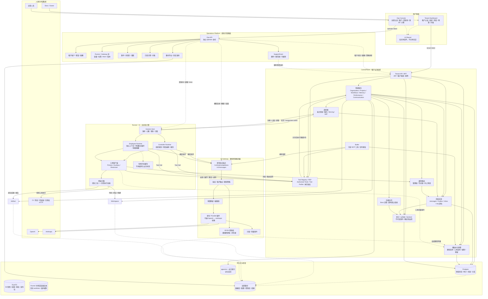
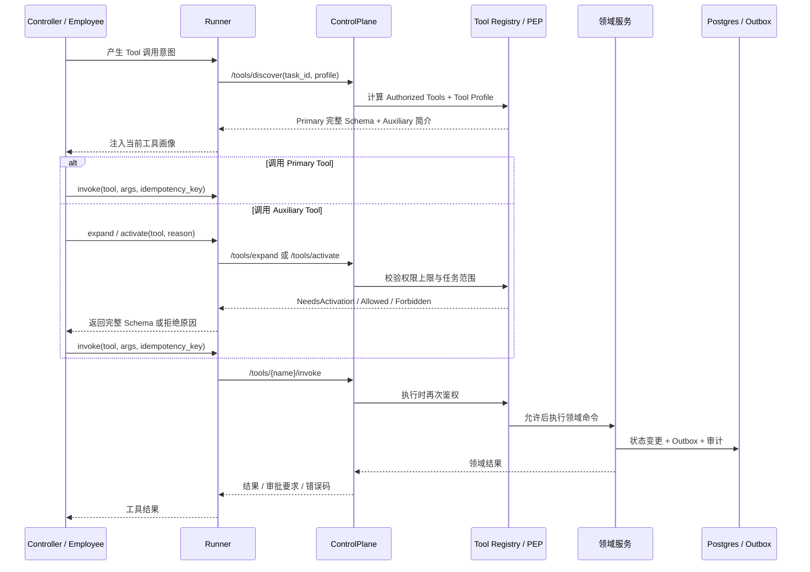
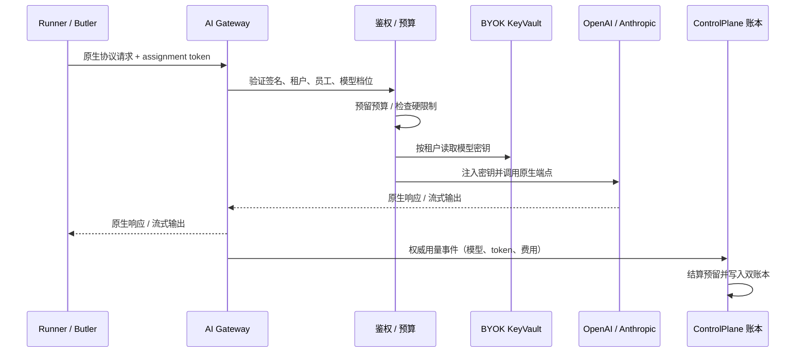
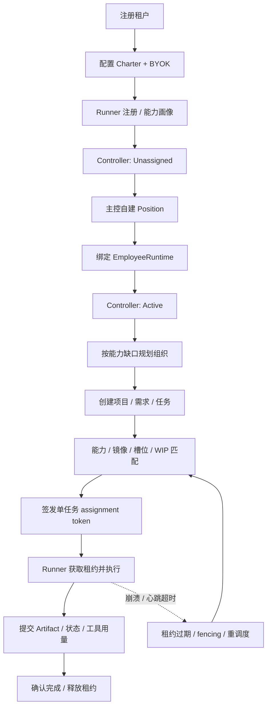
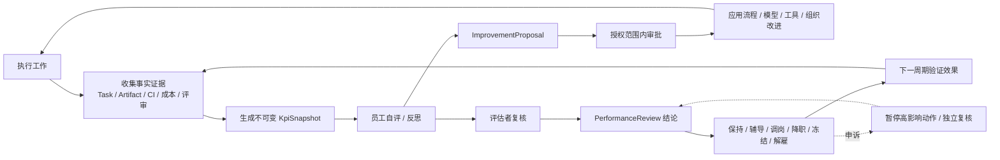

# Regent-Agent 完整架构流程图

> 用途：从用户入口、控制面、执行层、模型层、数据层和运营层检查整体架构是否闭环。  
> 状态：v0.1（待评审）  
> 配套文档：[技术设计总览](./Regent-Agent-技术设计.md) 与 [详细设计索引](./design/README.md)

## 1. 阅读说明

图中实线表示请求、命令或数据流，虚线表示事件、注册、管理或运维同步。

四部分边界：

1. **ControlPlane**：租户公司业务权威，不持有模型密钥。
2. **AI Gateway**：唯一持有模型密钥，负责原生协议代理、路由、预算和计量。
3. **Runner**：无状态 Controller/Employee 计算宿主，不持有持久业务真相。
4. **Operations Platform**：提供方账户、配额、资源池、事件、计费、备份和支持访问。

## 2. 总体架构流程图

## 3. Tool 发现、渐进披露与执行流程

关键点：

- `Authorized Tools` 是权限上限。
- `Tool Profile` 只决定默认披露什么。
- Auxiliary 展开后仍需 PEP 执行鉴权。
- Restricted 工具需要额外授权或审批。
- LLM 不能直接访问数据库或未注册函数。

## 4. 项目交付与组织协作闭环

```mermaid
flowchart LR
    Brief["产品简报 / 项目目标"] --> Project["创建并批准 Project"]
    Project --> Requirement["创建 Requirement<br/>范围 / 优先级 / 验收标准"]
    Requirement --> DoR{"就绪审查 DoR"}
    DoR -->|不通过| Requirement
    DoR -->|通过| Split["拆分 Task<br/>能力 / 估算 / 依赖 / WIP"]
    Split --> Ready["Task Ready"]
    Ready --> Assign["自动推荐或主动认领"]
    Assign --> Claim["原子认领"]
    Claim --> Work["开发 / 设计 / 执行"]
    Work --> Submit["提交 Artifact + 测试结果"]
    Submit --> Review{"评审 / 对抗审查"}
    Review -->|修改| Work
    Review -->|通过| Test["测试与独立验收"]
    Test --> Defect{"发现缺陷？"}
    Defect -->|是| Report["测试提交 Defect"]
    Report --> Fix["开发修复"]
    Fix --> Retest["测试复测"]
    Retest -->|未通过| Fix
    Retest -->|通过| Test
    Defect -->|否| Accept["Requirement Accepted"]
    Test --> Accept
    Accept --> Milestone["里程碑 / 发布门禁"]
    Milestone --> Release["发布 / 运行观测"]
    Release --> Retro["复盘 / 终止或迭代"]
    Retro --> Memory["沉淀 Memory / Knowledge Base"]
    Retro --> Workflow["改进 Workflow 候选"]
    Retro --> KPI["更新 KPI / Performance Review"]

    Requirement -.-> Discussion["线程讨论 / 证据 / 待办"]
    Work -.-> Discussion
    Review -.-> Discussion
    Discussion -.-> Debate["Debate / Review"]
    Debate -.-> Decision{"限时裁决"}
    Decision -.->|形成结论| Requirement
    Decision -.->|超时| Escalate["升级到决策者"]
    Escalate -.-> Decision
```

## 5. 模型调用、预算与计量流程

边界：

- OpenAI 使用 `/v1/chat/completions`。
- Anthropic 使用 `/v1/messages`。
- 不做 OpenAI 与 Anthropic 协议转换。
- 控制面不读取模型密钥。

## 6. 公司启动、调度与故障恢复

Runner 丢失进程内存不丢业务真相；任务、消息和账本以 Postgres 为准，快照和成果以 RustFS 为准，活动工作区可从快照重建。

## 7. 自驱动、KPI 与绩效闭环

KPI 是证据信号，不直接等于自动解雇。高影响动作需要充分样本、独立复核、申诉和审计。

## 8. 数据权威与信任边界

| 数据或能力 | 权威源 | 其他组件规则 |
|---|---|---|
| 公司组织、项目、工作项、消息 | ControlPlane / Postgres | Runner 只读缓存，不自行改写 |
| 模型密钥 | AI Gateway KeyVault | 控制面、Runner 和前端均不可读取 |
| 模型协议请求与响应 | 原生 Provider | 网关不转换 OpenAI 与 Anthropic 协议 |
| 模型用量与成本 | AI Gateway 用量事件 | Runner 不重复上报模型成本 |
| 工具用量 | Runner 用量事件 | 控制面入账并与模型成本分开 |
| 活动代码工作区 | Runner 本地或容器隔离目录 | 可丢失，从 RustFS 快照恢复 |
| 工作区快照、成果、报告、发布包 | RustFS | 未确认上传不得完成任务，Ready 对象不可覆盖 |
| 租户账户、套餐、资源池 | Operations Platform | 通过 Ops API/事件同步，不直接写租户表 |
| 工具权限 | CapabilityGrant + ToolPolicy | 发现层与执行层同时生效 |
| 审计与公司志 | ControlPlane 不可变事件 | 不提供静默改写或删除 |
| 员工任务身份 | ControlPlane assignment token | 与 Runner 部署身份分离 |

## 9. 可继续补充的架构视图

当前主图覆盖运行时闭环；以下内容适合后续单独出图，而不是继续堆进总图：

1. **招聘与面试流水线**：岗位、候选人、笔试、实操、评分、占槽与录用。
2. **模型评估与能力矩阵**：benchmark 版本、MCP 工具面、云端模型并发与结果复用。
3. **CI/CD 与发布环境**：Git 宿主、构建、测试、制品、发布、回滚和环境晋升。
4. **可观测性拓扑**：OpenTelemetry、指标、日志、追踪、告警、SLO 与错误预算。
5. **备份、恢复与迁移**：加密备份、主密钥恢复、租户导出和恢复演练。
6. **内部通知中心**：站内持久化、SignalR、分级和去重；外部渠道后置。
7. **商业化与计费**：套餐、支付渠道、发票、订阅状态和用量对账。
8. **公共 API 与插件生态**：公共 API、SDK、Webhook、MCP/插件市场和跨租户分享均后置。

## 10. 架构检查清单

- [ ] Runner 之间没有直接业务通信。
- [ ] 控制面不持有模型密钥。
- [ ] OpenAI 与 Anthropic 没有协议转换层。
- [ ] Tool 发现和执行都鉴权。
- [ ] 工具画像不能扩大权限上限。
- [ ] 项目状态不由 LLM 自由描述。
- [ ] 需求就绪、评审、缺陷复测和验收有确定性门禁。
- [ ] 高风险评审作者与评审者分离。
- [ ] 模型成本以网关为权威源。
- [ ] Runner 无持久业务缓冲。
- [ ] 租户控制面与运营平台身份、权限、界面和审计分离。
- [ ] 高影响绩效动作不能由 KPI 自动触发。
