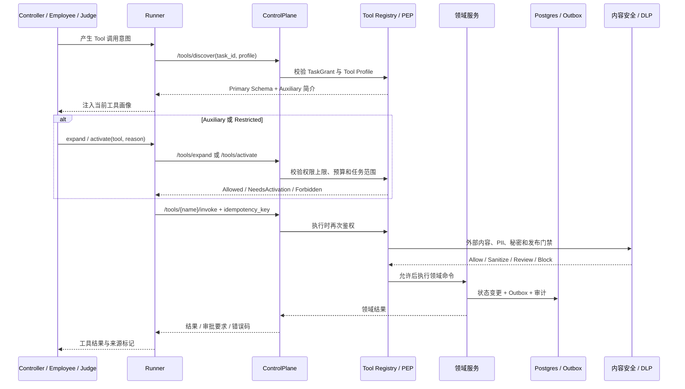
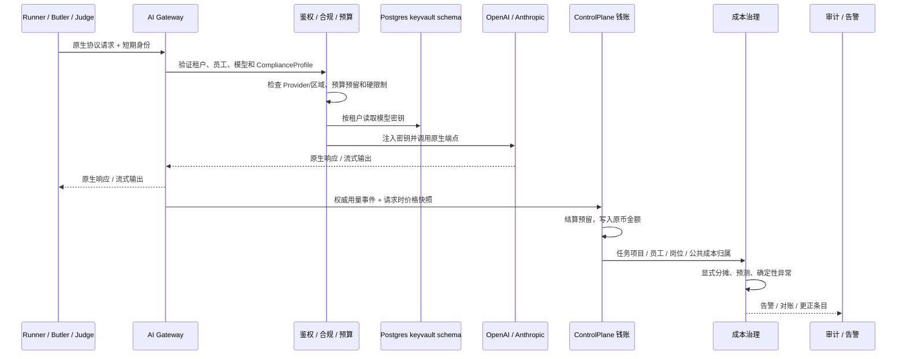
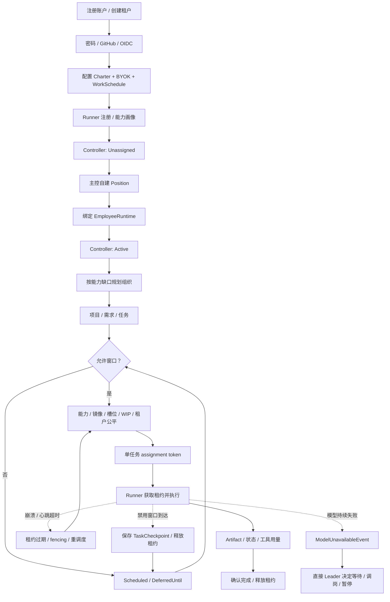
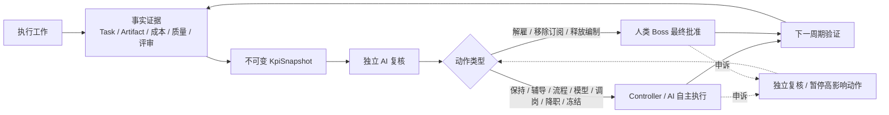
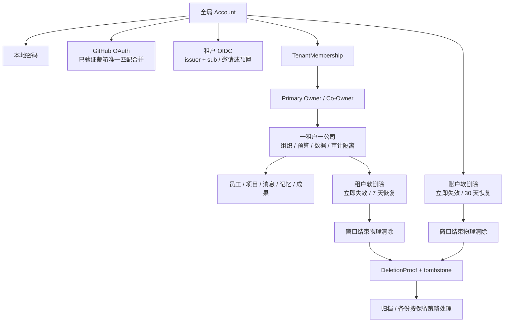
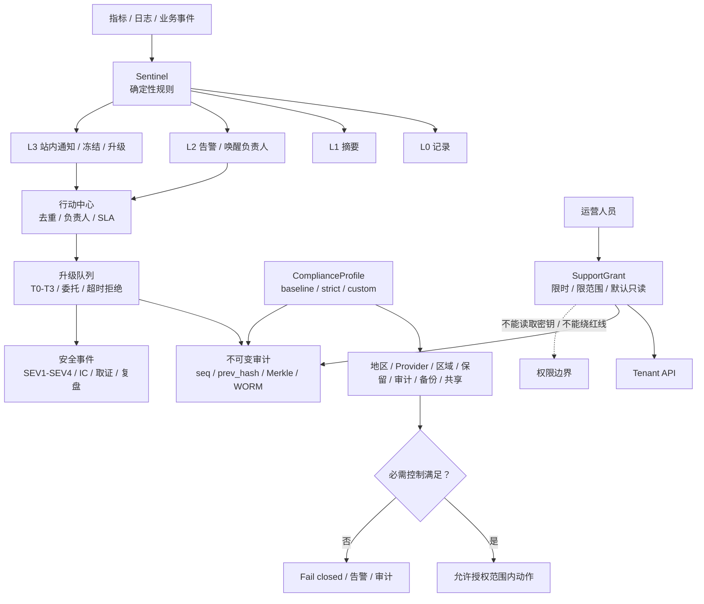
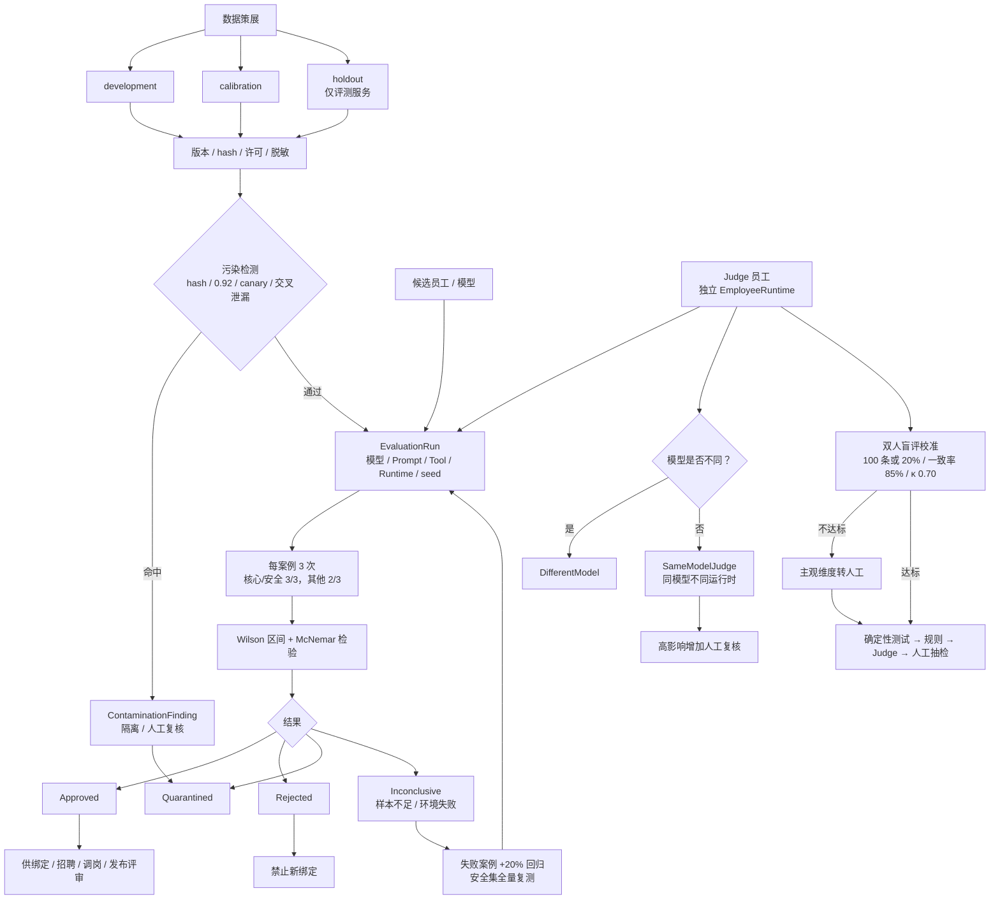
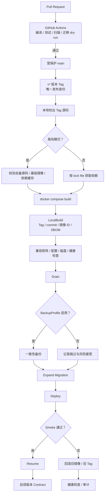

# Regent-Agent 完整架构流程图

> 用途：从用户入口、身份、控制面、执行层、模型层、数据层、治理层和自托管交付检查整体架构是否闭环。
>
> 状态：v0.2（Q-001～Q-052 决策同步）
>
> 配套文档：[技术设计总览](./Regent-Agent-技术设计.md)、[详细设计索引](./design/README.md)、[待确认项与决策记录](./Regent-Agent-待确认项.md)

## 1. 阅读说明

- 实线：请求、命令或数据流。
- 虚线：事件、注册、管理、审计或运维同步。
- 所有图均为逻辑架构，不代表当前代码已经实现。
- 当前边界：
  - 模型运行只支持 OpenAI 与 Anthropic 云端原生端点。
  - 通知只在仪表盘内部投递。
  - API、Tool 和 MCP 只用于系统内部。
  - 自托管使用 GitHub 版本 Tag 源码 + Docker Compose + systemd。
  - Q-033 数据导出与 Q-046 支付/套餐/定价保持延后。

四部分边界：

1. **ControlPlane**：租户公司业务权威，不持有模型密钥。
2. **AI Gateway**：唯一持有模型密钥，负责原生协议、预算和计量。
3. **Runner**：无状态 Controller/Employee/Judge 计算宿主，不持有持久业务真相。
4. **Operations Platform**：提供方账户、资源池、事件、支持访问和运维审计。

## 2. 总体架构

```mermaid
flowchart TB
    subgraph Humans["人类与外部系统"]
        Boss["Boss / Owner"]
        TenantUser["租户用户"]
        OpsOperator["运营人员"]
        GitHub["GitHub<br/>源码 / PR / Actions / Tag"]
        OpenAI["OpenAI"]
        Anthropic["Anthropic"]
        ExternalTools["CI / 测试 / 浏览器 / 已授权 HTTP"]
    end

    subgraph Identity["账户与认证"]
        Auth["本地密码 / GitHub OAuth / 租户 OIDC"]
        Session["租户会话<br/>15 分钟 access token"]
        OperatorAuth["独立 Operator 身份<br/>MFA / step-up"]
    end

    subgraph Frontends["用户界面"]
        TenantDashboard["Tenant Dashboard<br/>React 19 + MUI + SignalR"]
        OpsConsole["Ops Console<br/>React 19 + MUI + SignalR"]
        UIShared["UI.Shared<br/>TypeScript 包，不共享会话"]
        TenantDashboard -.-> UIShared
        OpsConsole -.-> UIShared
    end

    subgraph ControlPlane["ControlPlane：租户业务权威"]
        TenantAPI["Tenant API<br/>JWT / RLS / 幂等 / 版本"]
        Domain["领域服务<br/>组织 / 项目 / 工作流 / 记忆 / 绩效 / 通信"]
        Scheduler["调度器<br/>能力 / WIP / 租约 / fencing / 租户公平"]
        Messaging["消息总线<br/>Outbox / Inbox / seq 游标"]
        CommRoute["通信路由<br/>管理链 / 专业链 / 向上穿透"]
        ToolPEP["Tool Registry / PEP<br/>Tool Profile / TaskGrant / 执行鉴权"]
        Ledger["钱账与编制账<br/>模型 / 工具 / 项目 / 员工 / 预留"]
        CostGov["成本治理<br/>归属 / 分摊 / 异常 / 原币"]
        Notification["内部通知中心<br/>持久化 / SignalR / 去重"]
        AuditSentinel["审计 / 公司志 / Sentinel<br/>哈希链 / WORM / 确定性监控"]
        Butler["Butler<br/>只读 MCP / 定时报告"]
        Escalation["升级与审批<br/>T0-T3 / 委托 / SLA"]
        Compliance["ComplianceProfile<br/>必需控制 fail closed"]
        Evaluation["评测与回归<br/>密封集 / Judge 员工 / 统计门槛"]

        TenantAPI --> Domain
        TenantAPI --> ToolPEP
        TenantAPI --> Ledger
        TenantAPI --> Messaging
        TenantAPI --> Notification
        TenantAPI --> AuditSentinel
        Domain --> Scheduler
        Domain --> Messaging
        Domain --> ToolPEP
        Domain --> Ledger
        Domain --> AuditSentinel
        Domain --> Escalation
        Domain --> CommRoute
        Scheduler --> Messaging
        CommRoute --> Messaging
        Messaging --> AuditSentinel
        Butler --> ToolPEP
        Butler --> Notification
        Escalation --> AuditSentinel
        Ledger --> CostGov
        CostGov --> AuditSentinel
        Compliance -.-> Domain
        Compliance -.-> ToolPEP
        Compliance -.-> Evaluation
    end

    subgraph RunnerLayer["Runner × N：无状态计算"]
        RunnerHost["Generic Host<br/>注册 / 心跳 / 租约 / 恢复"]
        Controller["Controller Runtime<br/>组织规划 / 项目编排 / 继任"]
        Employee["Employee Runtime<br/>独立上下文 / 休眠唤醒"]
        Judge["Judge Employee Runtime<br/>独立评测上下文"]
        ToolClient["工具客户端<br/>Primary / Auxiliary / Restricted"]
        Sandbox["两层沙箱<br/>团队工位 / 一次性容器"]
        BoundedCache["有界内存缓存<br/>不承载持久业务状态"]

        RunnerHost --> Controller
        RunnerHost --> Employee
        RunnerHost --> Judge
        Controller --> ToolClient
        Employee --> ToolClient
        Judge --> ToolClient
        ToolClient --> Sandbox
        Employee -.-> BoundedCache
    end

    subgraph Gateway["AI Gateway：模型资源服务器"]
        GatewayAPI["原生协议端点<br/>/v1/chat/completions<br/>/v1/messages"]
        PolicyBudget["鉴权 / 合规 / 预算预留 / 硬限制"]
        Metering["计量 / 用量事件"]
        KeyVault["BYOK 密钥服务<br/>信封加密 / 轮换 / 唯一解密方"]
        NativeAdapters["原生 Provider 插件<br/>不做协议转换"]
        ModelCatalog["models.dev 快照<br/>价格 / 能力 / 档位"]

        GatewayAPI --> PolicyBudget
        PolicyBudget --> NativeAdapters
        NativeAdapters --> Metering
        PolicyBudget --> KeyVault
        ModelCatalog -.-> PolicyBudget
    end

    subgraph Operations["Operations Platform：提供方管理面"]
        OpsAPI["Ops API<br/>独立 audience / 审计"]
        TenantAccounts["租户账户 / 配额 / 状态"]
        ResourcePools["Runner / Gateway 池<br/>容量 / drain / 版本"]
        Incidents["事件 / 值班 / 复盘"]
        Support["SupportGrant<br/>限时 / 限范围 / 可撤销"]
        OpsBackup["可选备份 / 恢复审批"]

        OpsAPI --> TenantAccounts
        OpsAPI --> ResourcePools
        OpsAPI --> Incidents
        OpsAPI --> Support
        OpsAPI --> OpsBackup
    end

    subgraph Storage["持久化与恢复"]
        PG[("Postgres<br/>领域 / 账本 / 审计 / 消息 / RLS")]
        RustFS[("RustFS<br/>快照 / 成果 / 报告 / 归档")]
        LocalWorkspace[("Runner 本地或容器目录<br/>活动 worktree / 临时缓存")]
        SealedEval[("隔离评测存储<br/>holdout / 答案 / Judge 材料")]
        KeyVaultPG[("Postgres keyvault schema<br/>密文 / wrapped DEK / 版本")]
        BackupStore[("可选加密备份<br/>默认关闭")]
    end

    Boss --> TenantDashboard
    TenantUser --> TenantDashboard
    TenantDashboard --> Auth
    Auth --> Session
    Session -->|tenant token| TenantAPI
    OpsOperator --> OpsConsole
    OpsConsole --> OperatorAuth
    OperatorAuth -->|operator token| OpsAPI

    OpsAPI -.->|状态 / 配额 / 策略| TenantAPI
    OpsAPI -.->|资源池 / drain| RunnerHost
    OpsAPI -.->|目录 / 健康 / 容量| GatewayAPI
    Support -.->|限时受控访问| TenantAPI

    Scheduler -->|任务 / assignment token| RunnerHost
    RunnerHost -->|注册 / 心跳 / 续租| Scheduler
    Controller -->|Tool Call| ToolPEP
    Employee -->|Tool Call| ToolPEP
    Judge -->|评测 Tool Call| ToolPEP
    ToolClient -->|发现 / 展开 / 激活 / 调用| ToolPEP
    ToolPEP -->|允许后执行| Domain

    Controller -->|模型请求| GatewayAPI
    Employee -->|模型请求| GatewayAPI
    Judge -->|Judge 模型请求| GatewayAPI
    Butler -->|模型请求| GatewayAPI
    NativeAdapters --> OpenAI
    NativeAdapters --> Anthropic
    Metering -.->|权威模型用量| Ledger
    ToolClient -.->|工具用量| Ledger

    Sandbox -->|临时工作区| LocalWorkspace
    Sandbox -->|提交成果 / 报告| RustFS
    Sandbox -->|受控执行| ExternalTools
    Domain --> PG
    Messaging --> PG
    Ledger --> PG
    AuditSentinel --> PG
    AuditSentinel --> RustFS
    Evaluation -.-> SealedEval
    GitHub -.->|Tag 源码 / CI 证据| LocalWorkspace

    PG -.-> BackupStore
    RustFS -.-> BackupStore
    KeyVault -->|独立 Gateway 角色| KeyVaultPG
    KeyVaultPG -.-> BackupStore
    OpsBackup --> BackupStore
```

## 3. Tool 发现、授权与执行

关键边界：

- `Authorized Tools` 是权限上限，`Tool Profile` 只控制默认披露。
- `TaskGrant` 预授权工作区、Tool、网络、预算和动作范围。
- 外部内容保留来源、hash 和 taint，摘要或记忆提升不能洗白。
- Restricted 工具和外部写动作仍需授权或审批。
- LLM 不能直接访问数据库、密钥或未注册函数。

## 4. 项目交付、成本与发布闭环

```mermaid
flowchart LR
    Brief["产品简报 / 成功指标 / 成本估算"] --> Project["批准 Project + BudgetEnvelope"]
    Project --> Requirement["Requirement<br/>范围 / 优先级 / 验收标准"]
    Requirement --> DoR{"就绪审查"}
    DoR -->|不通过| Requirement
    DoR -->|通过| Split["拆分 Task<br/>能力 / 权重 / 依赖 / WIP"]
    Split --> Claim["推荐 / 认领 / 原子 Claim"]
    Claim --> Work["开发 / 设计 / 执行"]
    Work --> Evidence["Artifact + 测试 + DoneEvidence"]
    Evidence --> Review{"独立评审 / 对抗审查"}
    Review -->|修改| Work
    Review -->|通过| Test["测试与独立验收"]
    Test --> Defect{"缺陷？"}
    Defect -->|是| Fix["修复 + 复测"]
    Fix --> Test
    Defect -->|否| Accept["Requirement Accepted"]
    Accept --> Gate{"发布门禁"}
    Gate -->|成本 / 质量 / 安全 / 许可 / 权利| ReleasePlan["ReleasePlan + 回滚点"]
    ReleasePlan --> Tag["GitHub 版本 Tag"]
    Tag --> LocalBuild["本地 Compose 构建"]
    LocalBuild --> Deploy["Drain / Expand / Deploy / Smoke"]
    Deploy --> Live["运行观测 / 成本归属"]
    Live --> Retro["复盘 / 终止或迭代"]
    Retro --> Memory["Memory / Workflow / KPI"]

    Work -.-> Cost["用量入账<br/>任务 → 项目 → 员工 / 岗位"]
    Cost -.-> Gate
    Evidence -.-> Rights["来源 / 第三方权利 / 人类贡献"]
    Rights -.-> Gate
    Gate -.-> Approval["T0-T3 审批 / 缺席协商"]
```

边界：

- 同一成果只有一个主任务权重，父子和协作任务不重复计分。
- 项目预算默认软限制，租户月度预算保持硬限制。
- 成本按任务项目优先归属，公共成本默认不分摊。
- 发布必须通过功能、易用性、设计、安全、许可和权利门禁。
- GitHub 只打 Tag；本地从 Tag 构建，不发布镜像。

## 5. 模型调用、预算与成本治理

边界：

- OpenAI 使用 `/v1/chat/completions`，Anthropic 使用 `/v1/messages`。
- 不做 OpenAI 与 Anthropic 协议转换，不支持本地 GPU 或 Ollama。
- 模型密钥密文存 Postgres `keyvault` schema，主密钥不进入数据库。
- 控制面、Runner 和前端不能读取模型密钥。
- 模型费用以 Gateway 为权威源，Runner 只上报工具用量。
- 金额只保存原币和币种，不同币种不直接相加。
- 异常不自动改预算、换模型或处罚员工。

## 6. 公司启动、调度与故障恢复

- 默认全天 24 小时可配置，不默认禁止夜间。
- 可延期 P2/P3 可利用低价窗口，P0/P1 不等待低价窗口。
- 用户禁用窗口内的普通任务排队，安全事件可按 WakePolicy 紧急唤醒。
- 模型失败只允许同模型、同版本、同推理强度和同协议恢复。
- 任务、消息和账本以 Postgres 为准，快照和成果以 RustFS 为准。

## 7. 自驱动、绩效与人类责任边界

- KPI 和成本异常只是证据，不直接触发处罚。
- 人类只参与解雇和事后审查，不管理其他日常绩效动作。
- 高影响动作仍需独立复核、申诉和审计。
- 超时不默认批准解雇。

## 8. 账户、租户与删除边界

- 外部身份只增加登录方式，不转移租户所有权或权限。
- GitHub 可使用已验证邮箱自动合并；OIDC 不按邮箱自动建户。
- 删除立即逻辑生效，凭据立即撤销。
- 法律保留只限制物理清除，不恢复普通访问。
- tombstone 防止已删除身份复活。

## 9. 治理、审计、合规与支持

- 通知只进入仪表盘，SignalR 只是实时增强。
- ComplianceProfile 可配置，但不能关闭租户隔离、秘密保护和审批红线。
- 技术证据不等于认证，平台不宣称 SOC 2、ISO 27001 或等保。
- 当前没有商业 SLA、24×7 值班或专属支持。
- 自托管默认没有外部运营访问。

## 10. 模型评测、Judge 员工与统计门禁

- Judge 是正式员工，不是主控分身。
- 模型可以相同，员工运行时和评测上下文必须独立。
- Judge 不能评审自己的产出，也不能读取候选员工记忆、聊天或工作区。
- 安全失败立即 Quarantine，失败不自动换模型或处罚员工。

## 11. GitHub CI/CD 与自托管部署

- 不发布镜像，不使用 GHCR。
- 不提供二进制安装包、激活或自动更新。
- 离线缓存缺失必须快速失败；完全断网无法调用云端模型。
- 构建或迁移失败不切换运行版本。
- Contract 后禁止应用回滚，只能前滚或恢复可用备份。
- 所有步骤记录版本、操作者、配置、结果和风险接受。

## 12. 数据权威与信任边界

| 数据或能力 | 权威源 | 其他组件规则 |
|---|---|---|
| 账户与登录身份 | ControlPlane 身份服务 | GitHub 已验证邮箱可合并；OIDC 使用 issuer + sub |
| 公司组织、项目、工作项、消息 | ControlPlane / Postgres | Runner 只读缓存，不自行改写 |
| 员工任务身份 | ControlPlane assignment token | 与 Runner 部署身份分离 |
| 模型密钥 | Gateway / Postgres `keyvault` schema | 密文仅 Gateway 可解密，主密钥不进入数据库 |
| 模型协议请求与响应 | OpenAI / Anthropic 原生端点 | 网关不转换协议，不支持本地模型 |
| 模型用量与成本 | AI Gateway 用量事件 | Runner 不重复上报模型成本 |
| 工具用量 | Runner 用量事件 | 控制面入账并与模型成本分开 |
| 成本归属与分摊 | ControlPlane 钱账 | 只记一次，公共成本默认不分摊 |
| 活动代码工作区 | Runner 本地或容器隔离目录 | 可丢失，从 RustFS 快照恢复 |
| 工作区快照、成果、报告、归档 | RustFS | PendingUpload 未确认不得完成任务 |
| 密封评测数据 | 隔离评测存储 | 普通员工、记忆、Prompt 和遥测不可访问 |
| 租户账户、配额、资源池 | Operations Platform | 通过 Ops API/事件同步，不直接写租户表 |
| 支持访问 | SupportGrant | 限时、限范围、可撤销、默认只读 |
| 合规策略 | ComplianceProfile | 必需控制失败即 fail closed |
| 审计与公司志 | ControlPlane 不可变事件 | 不提供静默改写或删除 |
| 发布版本 | GitHub 版本 Tag | 本地 Compose 构建并记录镜像 ID |
| 备份 | BackupProfile 启用的组件 | 默认关闭，未启用不承诺 RPO/RTO |

## 13. 当前不做与延后项

| 项目 | 状态 |
|---|---|
| 数据导出、跨环境导入、托管退出 | Q-033 延后 |
| 本地 GPU、Ollama、本地模型档 | Q-044 明确不做 |
| Telegram、邮件、短信、其他 IM、出站 Webhook | Q-045 外部通知后置 |
| 支付、套餐、定价、订阅计费 | Q-046 延后 |
| 公共 API、公共 SDK、MCP/插件市场、跨租户分享 | Q-047 后置 |
| 二进制/GUI 安装包、激活、自动更新 | Q-048 不做 |
| 大规模多租户容量承诺 | Q-049 后置 |
| 企业认证声明、商业 SLA、专属支持 | Q-050 后置 |

## 14. 架构检查清单

- [x] Runner 之间没有直接业务通信。
- [x] 控制面不持有模型密钥。
- [x] OpenAI 与 Anthropic 没有协议转换层。
- [x] 模型运行只支持云端 Provider。
- [x] Tool 发现和执行都鉴权，TaskGrant 限定任务范围。
- [x] 工具画像不能扩大权限上限。
- [x] 外部内容保留来源和 taint。
- [x] 项目状态由确定性规则和证据驱动。
- [x] 高风险评审作者与评审者分离。
- [x] 模型成本以网关为权威源，成本只记一次。
- [x] Runner 无持久业务缓冲。
- [x] 租户控制面与运营平台身份、权限、界面和审计分离。
- [x] 高影响绩效动作不能由 KPI 或成本异常自动触发。
- [x] 人类只最终批准解雇并事后审查。
- [x] 删除立即生效，窗口结束后物理清除并生成证明。
- [x] 合规策略可配置，必需控制失败即拒绝。
- [x] Judge 是独立员工运行时，禁止自评和上下文共享。
- [x] 密封集、污染检测、校准和统计门槛可复现。
- [x] 通知只走站内，SignalR 不是唯一事实来源。
- [x] 前端使用 TypeScript SPA + SignalR，不使用 Blazor。
- [x] 自托管从 Tag 源码构建，不发布镜像或自动更新。
