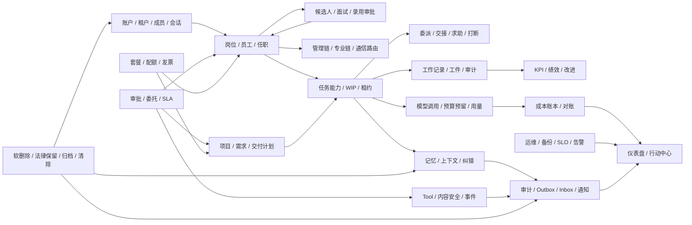

# 跨功能关联关系与场景试用

- 更新日期：2026-11-24
- 范围：当前本地实现的组织、项目、协作、记忆、预算、治理、身份、数据生命周期、计费与运维联动
- 用途：区分权威数据、派生投影和事件链路，指导跨模块场景试用；本文不把本地实现表述为生产就绪

## 1. 总览



## 2. 权威源与派生投影

| 领域 | 权威源 | 主要输入 | 下游投影 | 不应成为权威源的数据 |
|---|---|---|---|---|
| 身份与租户 | `UserRecord`、`TenantRecord`、`MembershipRecord`；会话/策略 JSON | 注册、邀请、OIDC、紧急恢复、租户切换 | 租户列表、设置页、权限 claims、审计 | 前端 sessionStorage、请求体 tenant_id |
| 组织 | `PositionRecord`、`EmployeeRecord`、`EmploymentPeriodRecord` | 公司启动、建岗、招聘、录用、调岗、离职、再入职 | 组织图、能力 scope、通信路由、编制统计 | 聊天消息、展示后缀 |
| 项目规划 | `ProjectRecord` + `ProjectDeliveryState` | 调研、简报、Go/NoGo、需求、拆分、评审、发布 | 项目详情、交付页、发布/回滚记录 | 单独的任务聊天 |
| 任务运行 | `TaskRecord`、租约、检查点、`WorkEntryRecord`、`ArtifactRecord` | 审批后的计划、认领、 checkpoint、完成/失败 | 工作时间线、协作图、审计、工件 | Runner 内存、本地未提交目录 |
| 协作 | `TaskCoordinationRecord`；会话/消息 JSON | 委派、交接、求助、P0/P1 打断、Agent 消息 | 协作面板、网络图、过程追溯、SignalR | @ 消息、普通聊天（不自动派工） |
| 记忆 | claim/vector/finding/correction/graph JSON | 捕获、提名、发布、投毒检测、纠错、遗忘 | 检索、任务上下文、影响图、通知、Outbox | 原始日志、未复核内容 |
| 模型与预算 | Gateway 价格快照、预留/账本 JSON、usage JSONL | Agent Token、模型、token、Provider 尝试 | Gateway 成本、对账案件、预算事件 | Runner 重复上报的模型费用 |
| 控制面成本 | `RuntimePolicyState` | 显式成本事件、更正、分摊、预算策略 | 成本摘要、项目预算视图 | 前端估算值 |
| 治理 | `ApprovalRecord`、`GovernanceState`、`AuditRecord` | 审批、Tool 准入、内容安全、安全事件 | 行动中心、通知、审计验证 | 未经签名的 Tool 结果 |
| 计费 | `BillingStateRecord` | Owner checkout、本地支付、套餐变更 | 配额门禁、发票、只增账本、设置/计费页 | 支付前端状态 |
| 数据生命周期 | `DataLifecycleState` + 对象 manifest + DB tombstone | 软删除、恢复、法律保留、归档、清除 | 删除证明、导出排除、运维报告 | 普通 API 的硬删除 |
| 运维 | Operations JSON、BackupJob/RestoreJob、AlertRecord | 租户状态、支持访问、备份、遥测样本 | 状态页、Ops Console、租户行动中心告警 | 租户业务内容 |

## 3. 关键关联链路

### 3.1 组织到任务执行

1. Owner 启动公司或创建岗位。
2. 候选人经评估和 Boss 审批后成为员工，并生成任职周期。
3. 任职岗位能力与 Agent baseline scope 合并，任务领取时签发任务级 Assignment Token。
4. 任务认领受状态、租约、WIP 和所有权约束；交接必须接收方确认，打断必须保存检查点。
5. 完成任务写入工作记录、持久工件和审计，员工时间线与协作图读取这些投影。

### 3.2 项目规划到交付

1. 项目创建后进入调研、简报和 Go/NoGo。
2. Go 决策后才能创建需求；需求验收标准和总权重完整后才能批准拆分计划。
3. 批准计划通过 `DeliveryRuntimeProjectionService` 幂等投影为运行时 `TaskRecord`；重复同步不重复建任务或审计。
4. 运行时认领和完成分别回写交付任务为 `Claimed` 和 `ReadyForReview`；HTTP 与 Agent `project.claim_task`/`project.submit_task` 都把状态投影到运行时任务，随后经独立评审和 DoneEvidence 完成。
5. 缺陷修复必须独立复测；P0/P1 未关闭阻断发布。
6. 发布后可观察健康、回滚或终止复盘。

### 3.3 记忆安全到任务上下文

1. 捕获 claim 时保留作者、范围、来源和 taint。
2. 注入或投毒 Finding 隔离 claim，搜索不再召回。
3. 独立 CorrectionTask 批准后生成新版本；个人记忆保留原作者 ACL，组织记忆由独立复核者署名，并传播影响、上下文失效、审计、Outbox 和通知。
4. 任务上下文只读取当前租户、员工和任务可见的记忆。

### 3.4 模型调用到成本与预算

1. Gateway 验证员工 Assignment Token、模型协议和 scope。
2. 调用前按不可变价格快照估算并预留金额。
3. 每次 Provider 尝试生成独立 usage event；流式中断也结算已报告 token。
4. 完成后释放预留并写只增账本；账单差异通过更正/退款条目处理。
5. Gateway 将每个 `usage_event_id` 写入持久投影队列，异步投递 `/internal/metering/usage`；ControlPlane 按事件 ID 幂等入账、校验租户/员工/任务归属并更新项目支出，失败退避重试。
6. 租户、项目、员工和公共成本是同一账目的不同视图，不重复计费。

### 3.5 审批、审计与通知

1. 高风险动作创建审批，决策幂等且超时默认拒绝。
2. Tool 调用同时经过发现层过滤和执行层鉴权。
3. 关键写入追加审计；记忆等事件额外进入 Outbox/Inbox。
4. 审批、紧急访问、记忆安全等事件写站内通知；SignalR 只做实时增强。

### 3.6 身份、配额与数据生命周期

1. 套餐决定员工、项目和存储配额；`OrganizationService`、`ProjectService` 和 `TaskExecutionService` 在应用层执行门禁，HTTP、Agent/Tool 与 Runner 自动建员工入口不能绕过，terminated 员工不占用员工配额。
2. required SSO 撤销非 OIDC 会话，紧急凭据创建 15 分钟受限会话，响应明确返回 `sessionKind=Emergency`。
3. 租户软删除通过 GUID 值比较生效，并立即拒绝人类会话和 Agent 数据面访问；仅允许恢复和会话管理路径。
4. 法律保留阻止物理清除；清除必须传播到 DB、JSON 模块和对象，并生成证明。
5. Owner 导出包含数据库和模块状态，但排除凭据、会话、恢复码和 KeyVault。

### 3.7 运维告警到租户行动中心

1. 前端/API 遥测写入 Operations 样本。
2. SLO 失败按指纹生成 L1～L3 告警，支持确认、限期抑制和恢复。
3. ControlPlane 从共享告警存储生成只读行动中心项，不替代 Ops 告警状态。

## 4. 场景验证重点

| 关联 | 预设场景 | 关键断言 |
|---|---|---|
| 招聘 → 组织 → 配额 | 新租户启动、建岗、评估、Boss 审批、录用、Runner 认领未知 assignee | 员工/任职/岗位状态一致；Starter 员工配额不能被普通、Agent 或 Runner 自动建员工入口绕过 |
| 交付计划 → 调度 → 工作记录 | 创建项目、Go、需求、批准计划、认领、完成 | 批准计划的任务必须进入运行时任务表；完成必须回写交付状态、工作记录、工件和审计 |
| 离职 → 任务 → 私有记忆 | 员工仍有在途任务时离职 | 旧租约失效； terminated 员工不能被重新认领；私有记忆隔离；审计可追踪 |
| 记忆投毒 → 纠错 → 事件 | 捕获注入记忆、隔离、独立纠错、搜索 | 隔离期不可召回；纠错后可召回；Outbox/Inbox、通知和审计完整 |
| 预算 → Provider → 对账 | Agent 调用本地模型、制造账单差异 | 预留头存在；每次尝试独立用量；结算释放；更正不修改原账目 |
| 软删除 → 访问 → 恢复 | 租户软删除后继续使用原会话和 Agent Token | 人类与 Agent 访问均 fail closed；恢复后需重新建立有效会话 |
| 套餐 → 配额 → 本地支付 | Starter 创建项目到达上限、升级 Pro 后重试 | 上限前 429/409；本地支付只记一次账；升级后配额立即生效 |
| OIDC → 紧急恢复 | required SSO、紧急凭据、普通 API 与 SSO 恢复 API | 密码/GitHub 被拒；紧急会话 15 分钟且只能访问恢复动作 |
| 遥测 → SLO → 行动中心 | 推送失败样本、确认、恢复 | 告警去重、状态转换正确，行动中心只读投影随之出现/消失 |
| 备份 → 恢复审批 | 启用组件备份、双人恢复演练 | 作业、manifest、RPO/RTO 和审批证据一致 |

## 5. 场景发现与最终结论

首轮自动试用只有 S-07 通过；修复实现断链并修正脚本的 HTTP 状态码、响应字段和测试隔离后，S-01～S-10 全部通过。详细证据见 [跨模块预设场景试用矩阵](./scenario-trial-matrix.md)。

| 初始怀疑 | 最终结论 | 修复或验证证据 |
|---|---|---|
| 交付计划与运行时任务不同步 | 确认断链，已修复 | 计划批准幂等创建 `TaskRecord`；Runner 与 HTTP/Agent Tool 认领、提交、完成双向投影；S-01、`CrossFeatureProjectionTests` |
| 任务治理投影不更新运行时所有权 | 当前运行时认领以 `TaskRecord` 租约为准，治理工作台账是派生视图 | S-01 验证认领、完成、工作记录和审计；未发现第二条所有权真相 |
| 招聘/再入职/Runner 自动建员工绕过套餐配额 | 确认断链，已修复 | 服务层调用 `ITenantQuotaGuard`；S-02 验证 Starter 第 5 人和未知 assignee 自动建员工均返回 409，Pro 升级后录用与认领成功 |
| 离职不清租约、terminated 员工可再认领 | 确认断链，已修复 | 在途任务转 `Interrupted` 并清租约；认领排除 terminated 员工；S-03、两项回归测试 |
| 软删除不阻止现有会话/Agent Token | 确认断链，已修复 | 人类与 Agent 中间件 fail closed；GUID 值比较修复 404；S-06、软删除回归测试 |
| Gateway 用量不进入控制面成本 | 确认断链，已修复 | 持久投影队列、异步重试、事件 ID 幂等、归属校验和项目支出更新；S-05、`UsageProjectionTests` |
| 租户清除覆盖范围 | 现有本地清除链路保留，未作为本轮十条场景新增证明 | 既有 `DataLifecycleServiceTests`、导出与清除设计仍以真实生产存储验证为边界 |
| Owner 导出包含计费但排除身份秘密 | 现有导出白名单包含 `billing.json`，排除身份策略、紧急凭据和 KeyVault | 既有 `DataExportServiceTests`；本轮未改变导出白名单 |

## 6. 复现方式与边界

```bash
python3 scripts/scenario-trial.py
```

- 场景使用独立租户、唯一 SLO/备份profile 和随机标记，不依赖上一步残留状态。
- 报告写入被 Git 忽略的 `data/scenario-trial-report.json`，只保留本地证据，不提交租户运行数据。
- 当前验证仅覆盖本地 ControlPlane、Gateway、Operations 和确定性 Provider；不连接真实 IdP、Provider、Postgres、RustFS、支付或容器。
