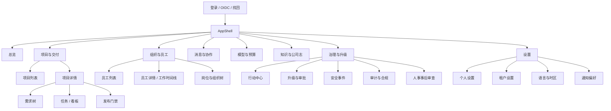
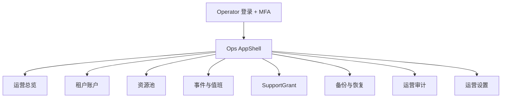

# 48 前端页面与路由地图

- 版本：v0.1（待评审）
- 范围：Tenant Dashboard 与 Ops Console 的页面、路由、权限、布局和组件映射
- 关联设计：[35 租户仪表盘信息架构](./35-tenant-dashboard-information-architecture.md)、[41 内部通知中心](./41-internal-notification-center.md)、[前端技术文档](../Regent-Agent-前端技术文档.md)

## 1. 范围

- 两个应用使用独立路由、认证和部署。
- Tenant Dashboard 不包含运营页面。
- Ops Console 不包含租户公司日常页面。
- 路由守卫只改善体验，服务端 API 仍逐次鉴权。
- 运营后台不进入租户导航。
- 开发期组件页 `/dev/components` 不进入生产导航。

## 2. Tenant Dashboard 站点地图

## 3. Tenant Dashboard 路由表

| 路由 | 页面 | 主要 Capability | 布局 | 核心组件 |
|---|---|---|---|---|
| `/login` | 登录 | 匿名 | AuthLayout | 登录表单、OIDC 按钮 |
| `/auth/callback` | OIDC 回调 | 匿名 | 最小布局 | 状态提示、错误恢复 |
| `/account/recovery` | 恢复码找回 | 匿名 | AuthLayout | 恢复码表单 |
| `/` | Boss 首屏 | `dashboard.read` | AppShell | 七类首屏卡片 |
| `/projects` | 项目列表 | `project.read` | ListLayout | ProjectListCard、FilterBar、DataTable |
| `/projects/:projectId` | 项目详情 | `project.read` | DetailLayout | ProjectDetailHeader、ProjectStageStepper |
| `/projects/:projectId/requirements` | 需求树 | `requirement.read` | DetailLayout | RequirementTree、EvidencePanel |
| `/projects/:projectId/tasks` | 任务看板 | `task.read` | DetailLayout | TaskBoard、FilterBar |
| `/projects/:projectId/releases` | 发布门禁 | `release.read` | DetailLayout | ReleaseChecklist、AuditTimeline |
| `/organization` | 组织与员工 | `organization.read` | ListLayout | OrganizationTree、EmployeeStateBadge |
| `/organization/collaboration` | 组织协作可视化 | `organization.read` | WorkspaceLayout | OfficeView、OrgChartView、NetworkView、ActivityTimeline、CoordinationPanel、TracePanel |
| `/organization/employees/:employeeId` | 员工详情 | `employee.read` | DetailLayout | EmployeeWorkTimeline、WorkLedgerTable |
| `/organization/positions` | 岗位管理 | `position.read` | DetailLayout | 岗位树、能力矩阵 |
| `/messages` | Agent 消息只读列表 | `message.read` | SplitLayout | ConversationList、NotificationMenu、AgentActorBadge |
| `/messages/:conversationId` | 会话详情 | `message.read` | SplitLayout | 消息流、委派/交接面板 |
| `/models` | 模型池 | `models.read` | DetailLayout | ModelBindingCard、ProviderRegionSelect |
| `/budget` | 预算与成本 | `budget.read` | DetailLayout | BudgetCostCard、CostBreakdownChart |
| `/knowledge` | 知识与记忆 | `memory.read` | DetailLayout | 搜索结果、来源和权限 |
| `/journal` | 公司志 | `journal.read` | DetailLayout | AuditTimeline、RecentDecisionList |
| `/governance/action-center` | 行动中心 | `action_center.read` | ListLayout | ActionCenterList |
| `/governance/approvals` | 升级与审批 | `escalations.read` | DetailLayout | ApprovalPanel |
| `/governance/incidents` | 安全事件 | `incident.read` | DetailLayout | IncidentTimeline |
| `/governance/audit` | 审计与合规 | `audit.read` | DetailLayout | ComplianceStatusCard、AuditTimeline |
| `/governance/performance-reviews` | 人事事后审查 | `performance.review.read` | DetailLayout | 审查列表、证据面板 |
| `/settings/profile` | 个人设置 | `self.manage` | SettingsLayout | 表单、会话管理 |
| `/settings/tenant` | 租户设置 | `tenant.manage` | SettingsLayout | 租户信息、成员和所有权 |
| `/settings/locale` | 语言与时区 | `self.manage` | SettingsLayout | LocaleSelect、DateTimeField |
| `/settings/notifications` | 通知偏好 | `self.manage` | SettingsLayout | 通知级别和静默设置 |
| `/dev/components` | 组件展示页 | 开发环境 | GalleryLayout | ComponentGalleryPage |

## 4. Ops Console 站点地图

## 5. Ops Console 路由表

| 路由 | 页面 | 主要角色 | 布局 | 核心组件 |
|---|---|---|---|---|
| `/login` | Operator 登录 | 匿名 | AuthLayout | MFA、登录表单 |
| `/` | 运营总览 | Ops Viewer | AppShell | 容量、事件、SLO 卡片 |
| `/tenants` | 租户列表 | Tenant Admin | ListLayout | TenantAccountTable |
| `/tenants/:tenantId` | 租户详情 | Tenant Admin | DetailLayout | 配额、状态、SupportGrant 历史 |
| `/resources` | Runner/Gateway 池 | SRE | DetailLayout | RunnerPoolPanel |
| `/incidents` | 事件与值班 | SRE/Security | ListLayout | IncidentTimeline |
| `/support-grants` | 支持授权 | Security Auditor | ListLayout | SupportGrantPanel |
| `/backups` | 备份与恢复 | SRE | DetailLayout | BackupStatusCard |
| `/audit` | 运营审计 | Security Auditor | ListLayout | OpsAuditTable |
| `/settings` | 运营设置 | Operator Admin | SettingsLayout | 角色、策略和值班配置 |

## 6. 页面布局类型

| 布局 | 适用页面 | 结构 |
|---|---|---|
| `AuthLayout` | 登录、OIDC、找回 | 品牌区 + 表单 + 帮助 |
| `AppShell` | 大多数业务页面 | 导航 + 顶栏 + 内容 |
| `ListLayout` | 项目、员工、行动中心 | PageHeader + FilterBar + DataTable |
| `DetailLayout` | 项目、员工、审批 | PageHeader + Tabs + Aside |
| `SplitLayout` | 消息、支持工单 | 列表 + 详情 |
| `SettingsLayout` | 租户和个人设置 | 设置导航 + 表单区 |
| `GalleryLayout` | 组件页 | 分类 + 搜索 + Demo |
| `WorkspaceLayout` | 组织协作可视化 | 视图切换 + 图/办公室/时间线 + 追溯抽屉 |

## 7. 路由与状态规则

- URL 保存可分享的筛选、分页、标签页和选中对象。
- 下钻保留来源筛选和返回位置。
- 页面刷新后恢复路由和 Query 状态。
- 无权限页面显示 PermissionDenied，不泄露资源细节。
- 会话过期返回登录并保存安全的目标路径。
- 租户切换后清空旧租户 Query 缓存和 SignalR 订阅。
- SignalR 重连后重新拉取当前页面快照。
- 移动端优先支持首屏、告警确认和审批。

## 8. 导航与权限

- 服务端返回可见导航和 Capability。
- 前端只做展示过滤，不替代 API 鉴权。
- 租户导航最多两级。
- Ops Console 使用独立导航树。
- 个人绩效、私人记忆和秘密不进入通用导航。

## 9. 页面验收

1. Tenant Dashboard 与 Ops Console 路由完全分离。
2. 所有关键页面有明确 Capability。
3. 所有列表页使用统一筛选和分页。
4. 所有详情页支持证据和审计下钻。
5. 员工详情包含工作时间线。
6. 项目详情包含需求、任务和发布门禁。
7. 行动中心和审批入口清晰。
8. 组件页只在开发环境启用。
9. 路由刷新、深链接和租户切换行为可测试。
