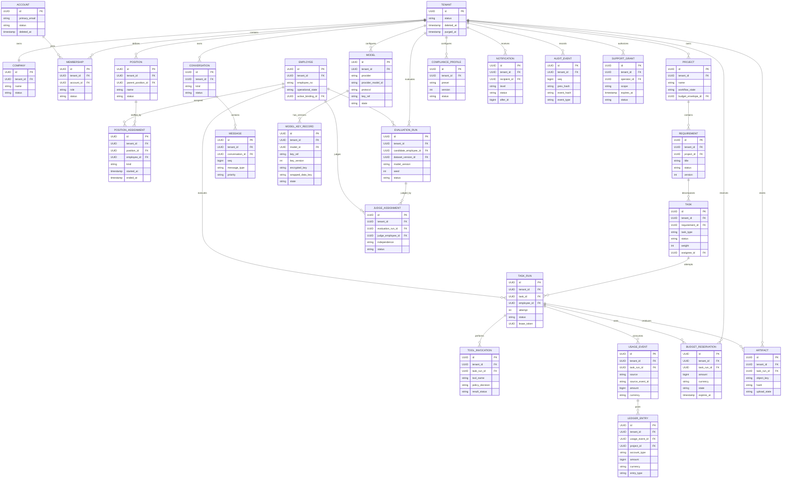

# 49 核心 ERD 与数据字典

- 版本：v0.1（待评审）
- 范围：租户、身份、组织、项目、消息、模型、账本、评测、治理和运营核心实体关系
- 关联设计：[15 数据 Schema 与事务边界](./15-data-schema-and-transactions.md)、[01 基础契约与状态模型](./01-contracts-and-state.md)、[后端技术文档](../Regent-Agent-后端技术文档.md)

## 1. 范围

- 本文是核心逻辑模型，不替代逐表迁移脚本和字段级 Schema。
- 所有租户业务表包含 `tenant_id` 并启用强制 RLS。
- 主键、唯一约束、外键和索引按租户隔离。
- 跨表外键使用复合 `(tenant_id, referenced_id)`。
- 状态使用稳定 `snake_case` 字符串，代码使用密封引用类型包装。
- 大文件和二进制内容存 RustFS，Postgres 只存元数据和对象引用。

## 2. 核心 ERD

## 3. Schema 所有权

| Schema | 主要实体 | 权威模块 |
|---|---|---|
| `identity` | Account、Tenant、Membership、Employee、Position、Assignment | ControlPlane Identity/Organization |
| `runtime` | Runner、TaskRun、Lease、ToolInvocation | ControlPlane Runtime |
| `projects` | Project、Requirement、Task、Defect、Review、Decision | Projects |
| `communication` | Conversation、Message、Route、Delegation、Handoff | Communication/Chat |
| `performance` | KPI、PerformanceReview、PerformanceAction | Performance |
| `models` | Model、Binding、Usage、Budget、Ledger | ControlPlane/Gateway |
| `keyvault` | ModelKeyRecord、KeyVersion、WrappedDataKey | Gateway |
| `evaluation` | Benchmark、EvaluationRun、Judge、Calibration | Evaluation |
| `governance` | Escalation、Compliance、Notification、Audit | ControlPlane Governance |
| `platform` | Operator、SupportGrant、ResourcePool、Backup | Operations |
| `dashboard` | 只读卡片、ProjectHealth、ActionCenter 投影 | ControlPlane Dashboard |

## 4. 核心数据字典

| 实体 | 关键字段 | 说明 | 权威源 |
|---|---|---|---|
| Tenant | id、status、deleted_at、purged_at | 安全、预算和数据边界 | ControlPlane |
| Account | id、email、status、deleted_at | 全局登录身份 | ControlPlane |
| Membership | tenant_id、account_id、role、status | 账户与租户关系 | ControlPlane |
| Company | tenant_id、name、status | 一租户一公司 | ControlPlane |
| Position | parent_position_id、name、capabilities | 动态岗位 | ControlPlane |
| Employee | employee_no、operational_state、binding | 独立员工运行时 | ControlPlane |
| PositionAssignment | employee_id、position_id、period | 任职历史 | ControlPlane |
| Project | workflow_state、budget_envelope_id | 项目生命周期 | Projects |
| Requirement | project_id、version、acceptance_criteria | 需求和验收锚 | Projects |
| Task | requirement_id、task_type、weight、status | 可认领工作项 | Projects |
| TaskRun | task_id、attempt、lease_token、status | 一次执行尝试 | Runtime |
| Conversation | kind、status、scope | 私人/群组/岗位会话 | Chat |
| Message | conversation_id、seq、priority | 租户内有序消息 | Communication |
| ToolInvocation | task_run_id、tool_name、policy_decision | Tool 执行和审计 | Runtime/PEP |
| Model | provider、model_id、protocol、key_ref | 模型元数据 | ControlPlane |
| ModelKeyRecord | encrypted_key、wrapped_data_key、version | Postgres 密钥库密文 | Gateway |
| UsageEvent | source_event_id、amount、currency | 权威用量 | Gateway/Runner |
| LedgerEntry | usage_event_id、project_id、entry_type | 只增不改钱账 | ControlPlane |
| BudgetReservation | amount、state、expires_at | 调用前预算预留 | ControlPlane |
| Artifact | object_key、hash、upload_state | RustFS 对象元数据 | ControlPlane |
| EvaluationRun | dataset_version、model_version、seed | 可复现评测 | Evaluation |
| JudgeAssignment | judge_employee_id、independence | Judge 员工和模型独立性 | Evaluation |
| ComplianceProfile | preset、version、status | 可配置合规策略 | Governance |
| Notification | recipient_id、level、status | 站内通知 | Governance |
| AuditEvent | seq、prev_hash、event_hash | 不可变审计链 | Governance |
| SupportGrant | operator_id、scope、expires_at | 限时运营支持 | Operations |

## 5. 关键关系与不变量

- 一个账户可以有多个 Membership，一个租户可以有多个成员。
- 第一梯队一个租户对应一个 Company。
- 一个员工同一时间只有一个 primary PositionAssignment。
- 一个岗位同一时间只有一个主任职者。
- Task 必须属于 Requirement，Requirement 必须属于 Project。
- TaskRun 通过租约和 fencing 防止旧 Worker 覆盖新结果。
- Message 的 `(tenant_id, seq)` 唯一。
- UsageEvent 的 `(source, source_event_id)` 唯一。
- LedgerEntry 只增不改，更正引用原条目。
- ModelKeyRecord 只存密文和包装数据密钥，主密钥不进入数据库。
- Artifact 只有 `Ready` 后才能被任务完成引用。
- JudgeAssignment 必须指向独立员工运行时，不能自评。
- ComplianceProfile 必需控制失败时相关动作 fail closed。
- AuditEvent 连续 `seq`、`prev_hash` 和 `event_hash` 不可静默改写。

## 6. RLS 与删除

- 租户业务表启用 `FORCE ROW LEVEL SECURITY`。
- 应用角色无 `BYPASSRLS`，不是表 Owner。
- 每个事务使用 `SET LOCAL app.tenant_id`。
- Account 根记录和 Tenant 根记录支持软删除。
- 软删除立即撤销会话、Token 和对象访问。
- 窗口结束后分批物理清除并生成 DeletionProof。
- tombstone 防止已删除身份复活。
- 法律保留只限制物理清除，不恢复普通访问。
- `keyvault` schema 使用 Gateway 独立角色，其他服务角色无访问权限。

## 7. 保留与归档

| 数据 | 默认保留 |
|---|---|
| 消息 | 在线 90 天 + 归档 1 年 |
| 任务和项目过程数据 | 在线 180 天 + 归档 3 年 |
| 账本和审计 | 租户终止后 7 年 |
| 密钥密文 | 模型存活期间，删除后按删除策略清除 |
| 评测原始材料 | 按数据集版本和合规策略保留 |
| 日志/指标/Trace | 14 天 / 30 天 / 7 天 |
| 备份 | 滚动最长 35 天，启用时生效 |

删除优先于归档；归档不是备份。

## 8. ERD 验收

1. 每个核心实体都有明确权威模块。
2. 所有租户实体包含 tenant_id 和 RLS 规则。
3. 密钥密文与主密钥分离。
4. 任务、用量、账本和审计链路可追踪。
5. Judge 员工与候选员工关系明确。
6. 软删除、物理清除和 tombstone 可表达。
7. 保留策略与归档边界一致。
